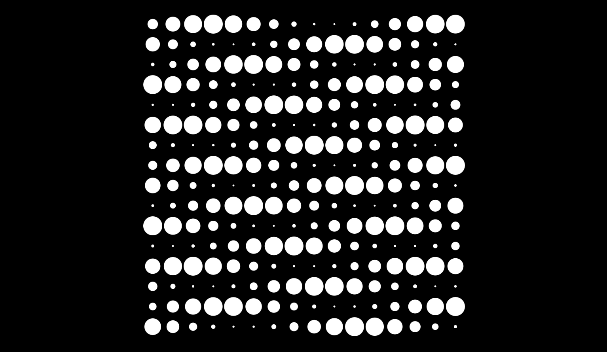
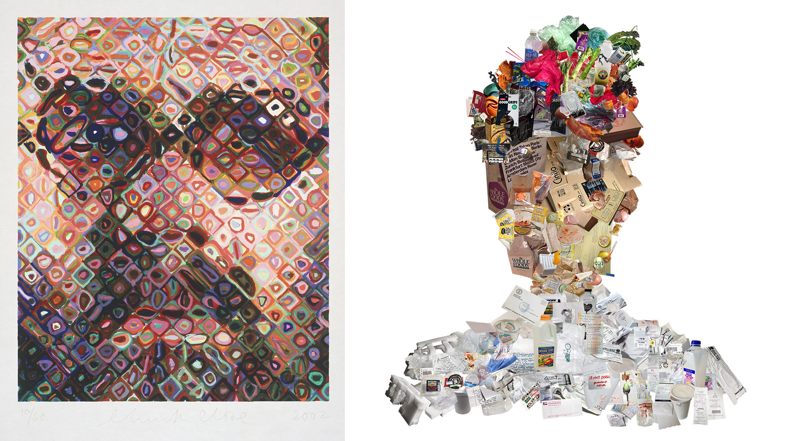
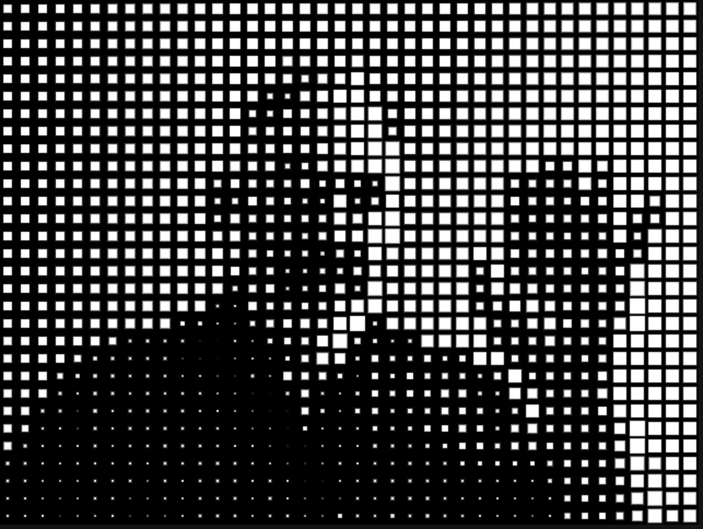
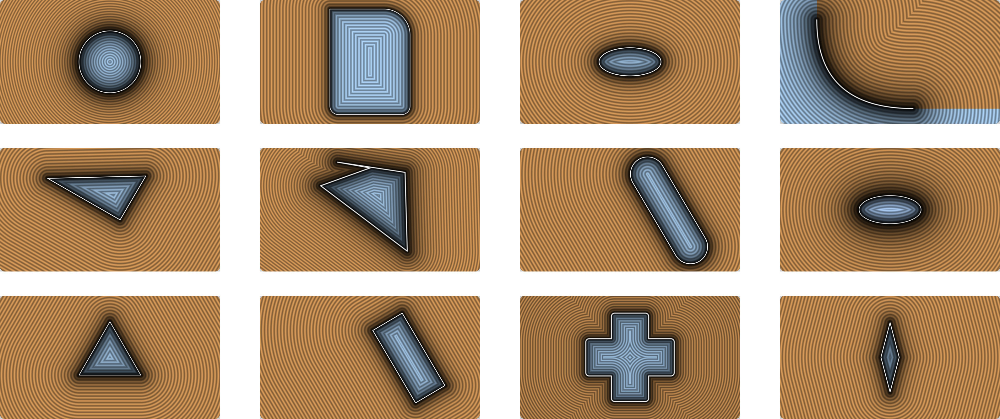
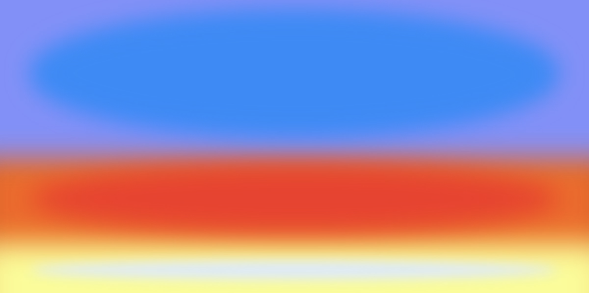

# Assignment Set #6: Pixel Logics

*In this assignment set, we'll explore different ways of constructing images from pixels, from tiny mathematical expressions to unconventional picture elements and GPU fragment shaders. Throughout, we'll investigate how simple rules applied to individual pixels can produce compelling patterns and animations.*

* 6.1. [Tixy.Land](#61-tixyland) *(5%, 15 minutes, due Monday 10/19)*
* 6.2. [Animated Composition for Flipdot Display](#62-animated-composition-for-flipdot-display) *(10%, 30 minutes, due 10/19)*
* 6.3. [Custom Pixel](#63-custom-pixel) *(30%, 2 hours, due Wednesday 10/21)*
* 6.4. [Looking Outwards](#64-looking-outwards) *(15%, 1 hour, due Wednesday 10/21)*
* 6.5. [Shader Composition](#65-shader-composition) *(40%, 3 hours, due Monday 10/26)*

---

## 6.1. Tixy.Land

*(5%, 15 minutes, due Monday 10/19)* In this very lightweight exercise, we get our first exposure to "data-parallel computing", or "SIMD (Single Instruction, Multiple Data) processing", wherein the same operation is applied to multiple data points (pixels) simultaneously. 

We will use [**tixy.land**](https://tixy.land/), a tiny online environment for JavaScript "code golfing" in which you will write a tiny program that is applied to a 16x16 grid of pixels. In Tixy, each "pixel" executes a common program whose only inputs are the current time (`t`), its index (`i`), and its `x` and `y` coordinates. *Now:*

To get started, **experiment** for a few minutes with the creative coding toolkit at [https://tixy.land](https://tixy.land/). When you feel like you've made something appealing, **paste** the URL of your creation in the Discord channel, `61-tixyland`. **Describe** your project with an evocative title.

---

## 6.2. Animated Composition for Flipdot Display

*(10%, 30 minutes, due Monday 10/19.) Using a SIMD approach, design an animation for a flipdot display.*

Flip-dot (or flip-disc) displays are widely used in transportation signage. Because of their extremely constrained colors and low resolution, they are an interesting platform for introducing foundational concepts in SIMD (Single Instruction, Multiple Data) programming, i.e. data-parallel computing or shader programming. In this project, you will control an electromechanical flip-dot display by writing a single-line JavaScript formula, similar to Tixy.Land. 

*Now:*

* Briefly **view** the following two artworks by Andreas Gysin & Sidi Vanetti: [*Digits 2*](https://vimeo.com/218010040), and [*Dots 4*](https://vimeo.com/160749809). Optionally, if you like this work, feel free to check out [this interview with the artists](https://verse.works/journal/verse-meets-andreas-gysin-sidi-vanetti), and some [related works by BreakfastNY](https://breakfaststudio.com/works/tides) ([1](https://theartistbreakfast.com/works/billion-dollar-arcade-series), [2](https://theartistbreakfast.com/works/world-skies-purple-sunset), [3](https://theartistbreakfast.com/works/orbital-debris)).
* **Study** the screenshot below, and **experiment** with our flipdot [**control software here**](https://openprocessing.org/sketch/2405498). **Observe** how there is a text field for composing a JavaScript expression. The expression must produce values that are either greater than zero (for *white*), or less-than-or-equal-to zero (for *black*). The expression controls the value of each pixel in the display, based on its `x`, `y`, `i` (index), and `t` (time, counted using `frameCount`). Note that, unlike Tixy.Land, there is *also* a variable `P[]` which contains a one-dimensional array of the pixels' previous states. 
* Here are some examples of programs that show off some features — using our flipdot [control software](https://openprocessing.org/sketch/2405498), **try** them out. **Observe** that you have access to the p5.js math functions, such as `noise()`. 
	* `sin(t-sqrt((x-7.5)**2+(y-6)**2))` — p5's math functions
	* `noise (x/10.0, y/10.0, t/10.0) - 0.5` — p5's 3D Perlin noise
	* `x < map(mouseX,30,width-30,0,28)` — mouse interactions
	* `(t==0)?(random()<0.1):P[(i+1)%(NUM_COLS * NUM_ROWS)]` — uses `P[]`
	* `((x+t)^y)%9` — a very compact generator!
	* `random() < 0.02` — low probability events 
	* `t & 2**i` — binary counting (Every Icon)
* **Tinker** and **devise** one or two different expressions whose results you like. Your results must depend in some way on `t` — that is, they must be time-based or animated. (Consider that the display produces sound as well as image!) We'll test out your ideas together in the late afternoon. 
* **Create** a post in the Discord channel, `#62-flipdots`. 
* **Paste** your JavaScript expression in the post. 
* **Include** a screenshot or animated GIF. Your exercise will be presented on the display in a public exhibition later this semester, in a looping sequence with the other students' exercises.

---

## 6.3. Custom Pixel

 *(Chuck Close; Jenny Odell)*

> *What if we change the elements from which an image is constructed?*

*(30%, 2 hours, due Wednesday 10/21)* Pixels are the fundamental building blocks of bitmap images and digital displays. Conventionally, pixels are square, uniform, and parked in a static Cartesian grid. Challenge these assumptions by writing code to reconstruct a webcam image using “custom picture elements” of your own devising. What if pixels were arranged on a hexagonal or irregular lattice? What if they overlapped, moved, or had a variety of sizes? What if an image was itself constructed from fragments of other images, or from a database of tiny icons, symbols, flags, or emojis? Can you break out of the grid? Can your picture elements be "intelligent"? Can you use graphics primitives in an interesting way?

[**This OpenProcessing tutorial**](https://openprocessing.org/@golan/2730399) demonstrates how to set up a video camera feed, and how to access the colors at a specified pixel location. Note, my screenshot above was created with a [template project by Dan Shiffman](https://openprocessing.org/sketch/2405701), which creates "custom pixels" by modifying the sizes of white squares. What will *your* custom pixel look like?

You might want to research the following terms in the p5 reference: [get()](https://archive.p5js.org/reference/#/p5/get), and [loadPixels()](https://archive.p5js.org/reference/#/p5/loadpixels). For additional instruction, consider these tutorials: *Coding Train* tutorials on [ASCII video](https://www.youtube.com/watch?v=55iwMYv8tGI) and [fetching color values from images](https://www.youtube.com/watch?v=0V3uYA1hafk); this [tutorial by Xin Xin](https://www.youtube.com/watch?v=aza-3oZjY4g); this [tutorial by Zach Whalen](https://www.youtube.com/watch?v=8geaKSvovoA); and tutorials on [spiral betty](https://www.youtube.com/watch?v=Z3PvLZYLW0U) and [ASCII art](https://www.youtube.com/watch?v=4IyeLc6J1Uo) by Patt Vira.

*Now*: 

* **Browse** these [viewings and reference materials](resources/custom_pixel_viewings.md) to see how others have approached this question.
* **Study** [the provided OpenProcessing tutorial](https://openprocessing.org/@golan/2730399) on accessing camera data and making custom pixels.
* **Create** a p5.js program that interprets the camera using custom picture elements. (You are *not* expected to use shaders for this assignment.)
* **Upload** your project to the [appropriate OpenProcessing collection](https://openprocessing.org/class/107236/#/c/107956).
* **Create** a post in the Discord channel, `#63-custom-pixel`.
* **Include** a screenshot or animated GIF of your project. 
* **Write** a couple of sentences describing your approach to designing a custom pixel.

---

## 6.4. Looking Outwards

*(15%, 1 hour, due Wednesday 10/21)* This exercise has **3 parts**. In overview, these are: 

1. **Take a photo** of the sky. Post it in Discord. 
2. **Review** a provided collection of artworks. Write a sentence about one that speaks to you.
3. **Scan** a large online collection of technical reference material, and identify one you think could be helpful. 

Together, these three exercises ask you to look closely at the visual world, discover how artists have worked with color and atmosphere, and begin exploring how similar effects might be created computationally.

### 6.4.1. Photograph the Sky

**Take a photograph** of a section of the sky. Your photo may not contain any people, trees, buildings, vehicles, ground, infrastructure, or parts thereof, etc.; the only permissible objects in your photo must be exclusively atmospheric and/or astronomical. Consider your cropping carefully, and pay attention to subtle variations in color, texture, and atmosphere. **Post** your photograph to the Discord channel `#641-sky`. In your post, **write** the time of day at which the photo was taken, and, if you're willing to share, the approximate location. 

### 6.4.2. Browse this Collection of Artworks

**Read** and **review** [this collection of artworks](../../lectures/no_hard_edges/README.md), which I've compiled from Romantic landscape painting, Tonalism, Impressionism, Abstract Expressionism, and contemporary computational work. **Select** one artwork that speaks to you. In the Discord channel `#642-no-hard-edges`, **identify** the work and **write** one or two sentences describing a specific visual quality that caught your attention. Try to articulate how the image works.

### 6.4.3. Review these Technical Resources

Briefly **survey** the following shader-programming resources. They vary considerably in their approaches, technical difficulty, and assumed background knowledge. **Choose** one that seems appropriate for your interests and current abilities, and **explore** it for 15–20 minutes. In the Discord channel `#643-shader-resource`, **identify** your chosen resource and **write** one or two sentences describing something specific you learned, or a technique you'd be interested in trying.

* [Introduction to Shaders for p5.js](https://v1.p5js.org/tutorials/intro-to-shaders/) (*note*: for p5v1)
* Patt Vira's *Introduction to Shaders* on YouTube: [Part 1](https://www.youtube.com/watch?v=q1xzpZu1KTc), [Part 2](https://www.youtube.com/watch?v=345Okku4qBA), [Part 3](https://www.youtube.com/watch?v=n7No2HiUUGc), [Part 4](https://www.youtube.com/watch?v=zSmNeJEom7s)
* [Freya Holmér *Shader Basics Lecture*](https://www.youtube.com/watch?v=kfM-yu0iQBk) (4 hours)
* [The Book of Shaders](https://thebookofshaders.com/) by Patricio Gonzalez Vivo and Jen Lowe
* [p5.js Shader Examples](https://github.com/aferriss/p5jsShaderExamples) by Adam Ferriss
* [Inigo Quilez's articles](https://iquilezles.org/articles/), and his [Signed Distance Functions](https://www.shadertoy.com/results?query=distance+2d) on ShaderToy
* [Acerola YouTube channel](https://www.youtube.com/@Acerola_t/videos) (making custom shaders for games)

---

## 6.5. Shader Composition

 *(Ruxandra Duru)*

> *What if we change the rules by which an image is generated?*

*(40%, 3 hours, due Monday 10/26)* **Create** a visual composition using a GLSL fragment shader. You are encouraged to make a composition with aspects that are generative, interactive, and/or time-based.

Until now, most of your p5.js drawings have been constructed by placing discrete geometric shapes. Shader programming offers a different way to make images: by describing how color and brightness vary across a field of pixels. It also offers a new technical vocabulary for some very old artistic problems: how to represent light, organize atmosphere, suggest depth, create luminosity, and direct the viewer's attention.

For this assignment, I encourage you to explore some of the possibilities we encountered in our *No Hard Edges* collection: soft boundaries, subtle gradients, ambiguous spaces, optical effects, luminous colors, and forms that emerge or dissolve. **These are suggestions, not requirements.** You are welcome to pursue an entirely different aesthetic direction.

Whatever direction you choose, pay attention to the *composition* of your image. Indistinctness is not the absence of structure, and visual complexity is not necessarily the same as visual interest. A carefully organized field of color can be as compelling as an intricate pattern of shapes.

### Instructions

* **Develop** a visual composition using GLSL. You may work from scratch, adapt an example, or fork one of the starter projects below. Experiment with shader techniques such as gradients, distance functions, noise, domain warping, color palettes, and periodic functions. You are not expected to master all of these techniques.
* **Consider** how your composition changes over space and, optionally, over time or in response to interaction. The important thing is to make deliberate visual decisions rather than merely demonstrate a shader effect.
* **Publish** your finished project as a p5.js sketch using a GLSL fragment shader, and submit it to our OpenProcessing classroom.
* **Create** a post in the Discord channel `#65-shader-composition`. In the post, **include** one or two screenshots of your project. In a sentence or two, **describe** an important visual decision you made, and what you hoped to achieve with it.

### Starter Templates

Here are two OpenProcessing templates you can **fork** and **use** to develop your project:

- [Simple Shader with Uniforms](https://openprocessing.org/@golan/2405238)
- [Simple Shader Template](https://openprocessing.org/@golan/3038198)

You may also do some of your shader development in another environment, such as ShaderToy or KodeLife, but your submitted project must run in p5.js on OpenProcessing. Be aware that different environments use slightly different GLSL conventions.

