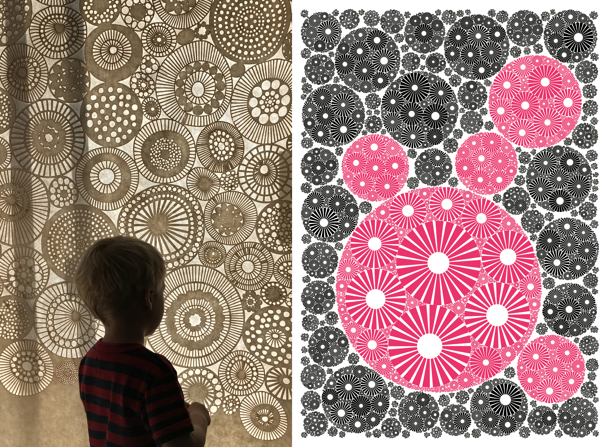
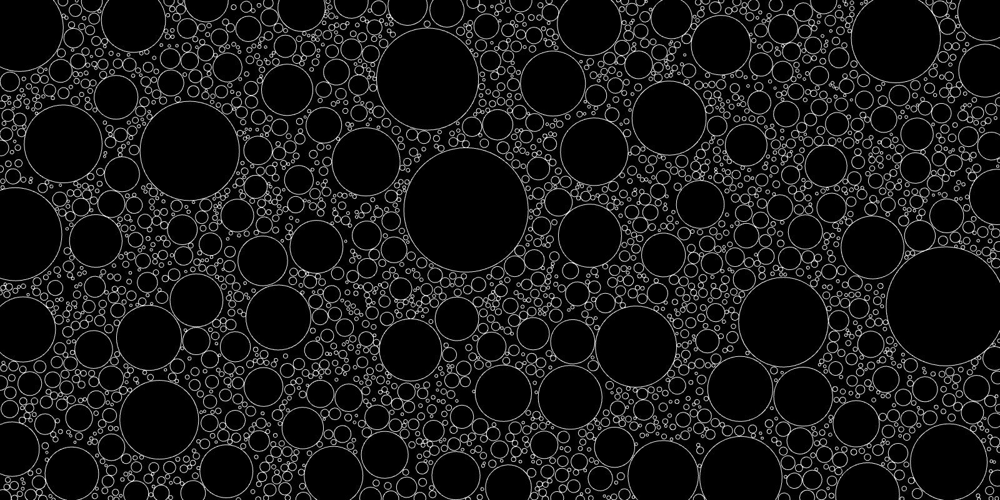
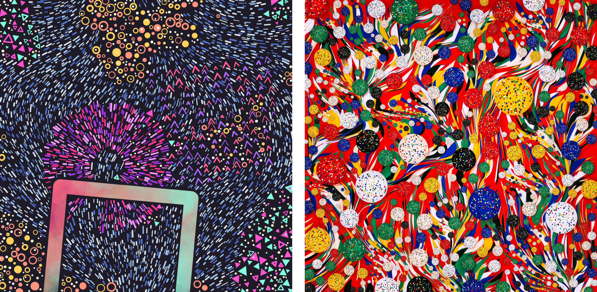
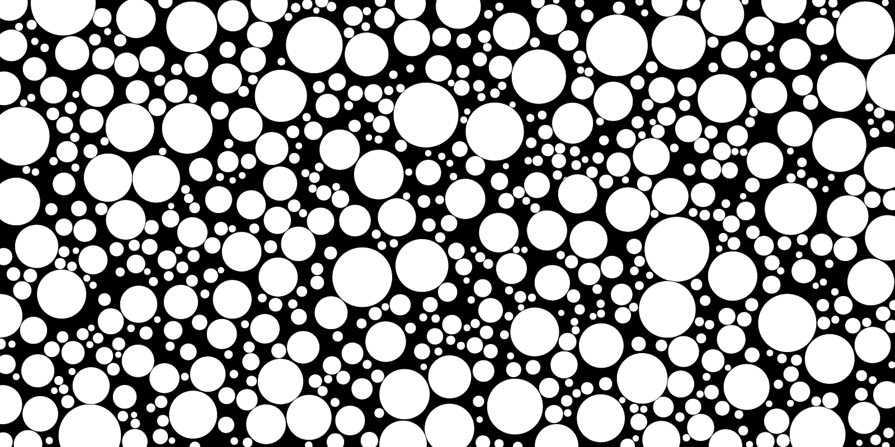
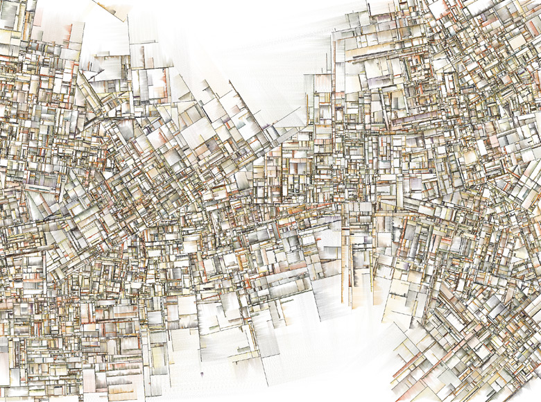
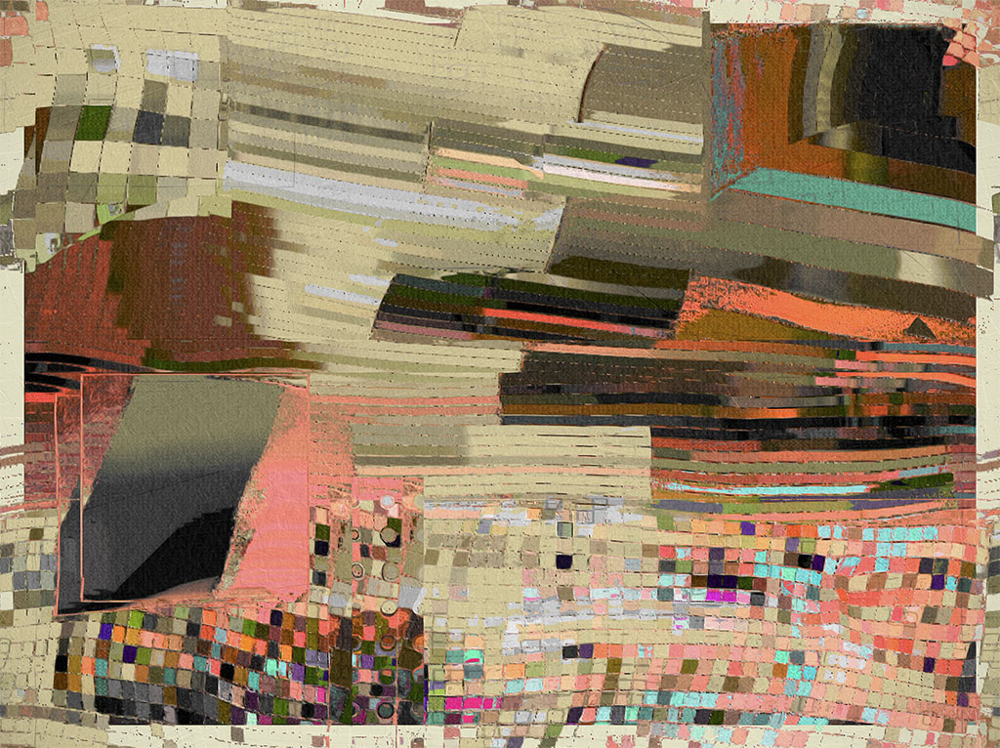
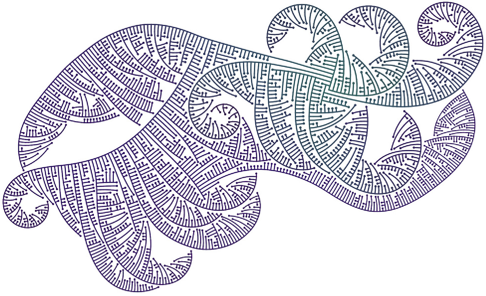

# Assignment Set #7: Feedback Drawing


*In this assignment set, we'll explore how generative drawings can respond to their own histories. We'll investigate techniques for storing and examining previously drawn marks, and for using that information to influence what gets drawn next. Along the way, we'll study a classic work of generative art, experiment with geometric and pixel-based feedback, and learn to export vector drawings as SVG files. Finally, you'll invent your own feedback-driven drawing system, developing a composition whose structure emerges from the interactions of its marks, and produce a physical drawing with a pen plotter.*

This unit has 6 exercises, of which #7.6 is the "main assignment". 

* [7.1. Circle Packing with Geometric Testing](#71-circle-packing-with-geometric-testing) *(10%, 30 minutes, due 10/28)*
* [7.2. Circle Packing with Pixel Testing](#72-circle-packing-with-pixel-testing) *(10%, 30 minutes, due 10/28)*
* [7.3. Guided Master Study: *Substrate*](#73-guided-master-study-substrate) *(20%, 60 minutes, due Monday 11/2)*
* [7.4. Simple SVG Generation](#74-simple-svg-generation) *(5%, 15 minutes, due Monday 11/2)*
* [7.5. Looking Outwards: Generative Art](#75-looking-outwards-generative-art) *(15%, 45 minutes; due Monday 11/2)* 
* [7.6. Feedback Composition (for Pen Plotting)](#76-feedback-composition-for-pen-plotting) *(40%, 6 hours; due Monday 11/9)*


---

<br/>Computational circle packing designs by [Leah Buechley](https://x.com/leahbuechley/status/936669240605552640?lang=en) (2017) and [Marius Watz](https://mariuswatz.com/) (2008).


## 7.1. Circle Packing with Geometric Testing



*(10%, 30 minutes) This is a* ***purely technical exercise*,** *intended to be completed in-class on Wednesday 10/28. For this exercise, I ask that you please* ***not use AI assistance.***

> **Note:** there are actually many possible [circle-packing techniques](https://en.wikipedia.org/wiki/Circle_packing), including the lovely [Apollonian Gasket](https://en.wikipedia.org/wiki/Apollonian_gasket) and [Soddy Circles](https://en.wikipedia.org/wiki/Soddy_circles_of_a_triangle), with different definitions of optimality. If you'd like to learn more about circle packing, check out these Coding Train videos on [Animated Circle Packing](https://www.youtube.com/watch?v=QHEQuoIKgNE) and the [Apollonian Gasket Fractal](https://www.youtube.com/watch?v=6UlGLB_jiCs). But here, we are using extremely simple packing techniques with the goal of exploring the creation of **images whose future states depend on their past states**. 

**Create** a p5.js program which uses ***geometric testing***, or explicit geometric memory, to create a circle-packing configuration. For the purposes of this exercise, "circle packing" means a collection of circles which do not intersect each other, and which do not contain each other. The key idea is that each new circle must be tested against the accumulated results of all previous decisions. As the composition develops, the available space for new circles progressively diminishes.

**Proceed** as follows:

* **Setup** a p5 canvas with dimensions of 800x600 pixels.
* **Generate** a circle with a random size and location on the canvas, and **store** information about the circle's geometry into an array called (e.g.) `bubbles`. 
* On every subsequent `draw()` call, **generate** a candidate circle with a new random size and location. **Test** to see whether the candidate circle overlaps any previously stored circle, including cases where one circle contains another. (You should be able to test this using [A-level Maths](https://www.youtube.com/watch?v=lDk_8pFzNZY) and/or the p5.js [`dist()`](https://p5js.org/reference/p5/dist/) function.) If the candidate circle does *not* overlap any previous circle, then **add** it to the array. To speed things up, you may wish to generate a number of candidate circles on each frame.
* **Display** the collection of non-intersecting circles by looping through the `bubbles` array to fetch their parameters. **Demonstrate** the success of your algorithm by rendering all of your circles as unfilled shapes, i.e. with a white stroke and `noFill()`.
* **Upload** your project into the [appropriate collection](https://openprocessing.org/class/107236/#/c/108053) on OpenProcessing.
* During discussion, be prepared to **answer**: what are some advantages and disadvantages of this technique for circle-packing? 


---

<br/>Computational shape packing designs by [Amy Goodchild](https://www.amygoodchild.com/blog/maplands) (2022) and Manolo Gamboa Naon (2021).


## 7.2. Circle Packing with Pixel Testing



*(10%, 30 minutes) This is a* ***purely technical exercise*,** *intended to be completed in-class on Wednesday 10/28. For this exercise, I ask that you please* ***not use AI assistance.***

**Create** a p5.js program which uses ***pixel testing***, or implicit visual memory, to create a circle-packing configuration. In this version of the circle-packing exercise, we will use the *pixels of the canvas itself* as the "memory" that stores the location of previous circles — technically, an *accumulation buffer* or *persistent raster occupancy map*.

**Proceed** as follows:

* **Create** a p5 canvas with dimensions of 800x600 pixels, and in the `setup()` function, set the `background()` to black. **Remove** any subsequent invocation of the `background()` function.
* **Generate** a circle with a random size and location on the canvas, and **draw** it using a white-filled `circle()` command. 
* On every subsequent `draw()` call, **generate** the geometric parameters `(cx,cy,r)` of a candidate circle with a new random size and location. In order to **test** whether that candidate circle overlaps any previously stored circle, **compute** a series of test points `(px,py)` at various angles `a` around its perimeter (using something like `px = cx + r * cos(a)`, *etcetera*). Then, **use** the p5.js `get()` command to fetch the colors at those locations. If all of the circle's points would be drawn at a black location, then you can safely **add** that circle to the accumulation buffer.
  * **Consider** whether this sampling technique guarantees that circles will never overlap.
  * **Consider** how the number of test points affects the reliability and performance of your algorithm. 
  * To speed things up, you may wish to generate a number of candidate circles on each frame.
* **Upload** your project into the [appropriate collection](https://openprocessing.org/class/107236/#/c/108054) on OpenProcessing.

### DISCUSSION

We will follow the implementation of exercises 7.1 and 7.2 with a brief discussion. Be prepared to **answer**:
 
* What are some **advantages and disadvantages** of each technique for circle packing?
* Both techniques produce images whose future states depend on their past states, but they store and query their histories differently. What are the **implications of these different representations** (e.g. for algorithmic efficiency)?
* Likewise, what kinds of visual effects or behaviors might be **easier to achieve** with one technique than the other?


---

## 7.3. Guided Master Study: *Substrate*

*(20%, 60 minutes, due Monday 11/2) In this exercise, you will study and modify an agent-based drawing system that combines movement, branching, and pixel-based collision detection.*



Jared Tarbell's *Substrate* (2003), originally implemented in Processing/Java, is considered a classic work of generative art. Here is an older [screen recording](https://vimeo.com/208903786), and here is a 2023 [re-code/homage by Tom White](https://dribnet.github.io/substrate/) that uses p5.js and runs in the browser. 

*Substrate* is related to a family of generative drawing systems known as [Ice-Ray Grammars](https://www.contrib.andrew.cmu.edu/~ramesh/teaching/course/48-747/subFrames/readings/Stiny-1977-EPB3_89-98.Ice-ray..pdf), described by George Stiny in 1977. These systems generate intricate networks of lines through simple rules governing their growth and interaction.

In *Substrate*, numerous lines — let us call them "cracks" — propagate across the drawing surface. Each crack advances incrementally in a particular direction, leaving a visible trace behind it. When a crack encounters another crack or reaches the edge of the canvas, it stops growing. New cracks originate along existing cracks, typically departing at approximately right angles. Over time, these simple interactions produce an increasingly intricate network of intersecting paths and subdivided regions. Tarbell's artwork also includes delicate, sand-like deposits of color alongside the cracks.

Below and [here at OpenProcessing](https://openprocessing.org/@golan/3046937) is a heavily simplified, approximately 100-line program, loosely based on *Substrate*. It introduces several computational ideas that go beyond our previous circle-packing exercises:

* **Persistent moving agents**. Instead of generating independent candidate shapes, each `Bug` object maintains its position, heading, and alive/dead state across frames.
* **Continuous mark-making**. Agents deposit connected line segments as they move, rather than adding complete geometric shapes.
* **Feedback during growth**. A bug reads the accumulated canvas to determine whether it should stop. In circle packing, an entire candidate circle is accepted or rejected at once.
* **Branching**. New agents inherit positions and headings from existing agents, producing a growing population of related trajectories.
* **Steering**. Perlin noise introduces local variation into the agents' movement, allowing cracks to curve rather than simply travel in straight lines.

### Your Task

Starting with the code provided below, **create** your own modified version of [this generative drawing system](https://openprocessing.org/@golan/3046937). *(You are not asked to reproduce Substrate.)* Your goal is to **understand** the existing mechanisms, **experiment** with their behavior, and **make** deliberate changes to the rules that generate the drawing. See if you can *make it your own*.

* **Study** Tarbell's *Substrate*, either from the [screen recording](https://vimeo.com/208903786) or from [Tom White's interactive re-code](https://dribnet.github.io/substrate/). **Observe** how new cracks originate, propagate, branch, and terminate. Notice how the composition becomes increasingly complex as marks accumulate.
* **Fork** the [provided sketch](https://openprocessing.org/@golan/3046937) into your own p5.js project. Run it and examine the code. In particular, identify where the program:
  - Creates and stores its moving agents;
  - Updates their positions and directions;
  - Tests the accumulated canvas for collisions;
  - Creates new agents through branching;
  - Determines when an agent stops moving.
* **Experiment** with the program's parameters, including `branchProbability`, `noiseInfluence`, `noiseScale`, and `hitThreshold`. Observe how each parameter affects the density, curvature, branching, and overall structure of the drawing. Try changing the number and distribution of the initial agents, too.
* **Modify** the program in at least two meaningful ways. At least one modification must change a behavioral rule, rather than merely adjusting a parameter or altering a drawing command. Some possibilities include:
  - Changing the angles at which new cracks branch;
  - Making cracks branch when they encounter another crack;
  - Making the probability of branching depend on an agent's age, position, or other properties;
  - Changing how agents steer, perhaps using trigonometric functions or a different noise field;
  - Giving different agents different speeds, lifespans, or behaviors;
  - Changing the conditions under which agents stop moving;
  - Introducing a new way for agents to respond to the marks already drawn.
  - Note that you should probably retain the simple coloring (black lines on white background); doing otherwise may break the pixel-based feedback algorithm.
* **Upload** your modified project to the [appropriate collection](https://openprocessing.org/class/107236/#/c/108055) on OpenProcessing. 
* **Create** a post in the Discord channel `#73-substrate`. **Write** a brief comment explaining the two most significant changes you made and what effects they had on the drawing.
* **Include** a screenshot or two of your program in your Discord post. 


```javascript
const hitThreshold = 200;
let branchProbability = 0.05;
let noiseInfluence = 0.05;
let noiseScale = 0.1;

let bugs = [];
function setup() {
  createCanvas(700, 500);
  init();
}

function mousePressed() {
  init();
}

function init() {
  noiseScale = 0.1;
  noiseInfluence = 0.05;
  bugs = [];
  noiseSeed(millis());
  background(255);
  for (let i = 0; i < 10; i++) {
    let px = random(width);
    let py = random(height);
    let heading = random(TWO_PI);
    bugs.push(new Bug(px, py, heading));
    bugs.push(new Bug(px, py, heading + PI));
  }
}

function draw() {
  // Potentially change some properties over time
  // branchProbability *= 1.0;
  // noiseScale *= 1.0;
  // noiseInfluence *= 1.0;

  let bDidIt = false;
  for (let i = 0; i < bugs.length; i++) {
    if (!bDidIt && bugs[i].plive) {
      if (random(1.0) < branchProbability) {
        let px = bugs[i].px;
        let py = bugs[i].py;
        let pheading = bugs[i].pheading;
        if (!isNaN(px) && !isNaN(py)) {
          let sig = random(1) < 0.5 ? -1 : 1;
          bugs.push(new Bug(px, py, pheading + sig * HALF_PI));
          bDidIt = true;
        }
      }
    }
  }

  stroke(0);
  strokeWeight(1);
  strokeCap(SQUARE); // unexpectedly important
  for (let i = 0; i < bugs.length; i++) {
    bugs[i].update();
  }
}

//------------------------------------
class Bug {
  constructor(ipx, ipy, iheading) {
    this.px = ipx;
    this.py = ipy;
    this.pheading = iheading;
    this.plive = true;
  }

  update() {
    if (this.px > 0 && this.px < width && this.py > 0 && this.py < height) {
    } else {
      this.plive = false;
    }

    if (this.plive) {
      let nx = this.px * noiseScale;
      let ny = this.py * noiseScale;
      this.pheading += noiseInfluence * (noise(nx,ny) - 0.5);

      let vx = cos(this.pheading);
      let vy = sin(this.pheading);
      this.px += vx;
      this.py += vy;
      if (!isNaN(this.px) && !isNaN(this.py)) {
        let fpx = this.px;
        let fpy = this.py;
        let pcol = get(fpx, fpy);
        if (pcol[0] < hitThreshold) {
          this.plive = false;
        }
        line(this.px, this.py, this.px - vx, this.py - vy);
      }
    }
  }
}
```


---

## 7.4. Simple SVG Generation

*(5%, 15 minutes, due Monday 11/2)*

The purpose of this simple technical exercise is to make sure you understand how to use the [p5.plotSvg library](https://github.com/golanlevin/p5.plotSvg/blob/main/README.md) to generate and share SVG files for pen-plotting. No creative work is required. 

* **Skim** the [main README for p5.plotSvg](https://github.com/golanlevin/p5.plotSvg/blob/main/README.md), a library that I created to support plotter-friendly SVG export for p5.js. But be sure to actually **read** the [Quickstart Instructions](https://github.com/golanlevin/p5.plotSvg/blob/main/README.md#quickstart-installation-instructions) section.
* **Run** the following example programs at OpenProcessing. Study their code (it's simple). Test out how you can use them to **export** SVG files. 
  - [plotSvg Generative](https://openprocessing.org/@golan/2455399)
  - [plotSvg Particle Paths](https://openprocessing.org/@golan/2478945)
  - [plotSvg Hello Animating](https://openprocessing.org/@golan/2455390)
* **Examine** these apps' resulting SVG files in your favorite vector editor, such as Adobe Illustrator, [VectorCraft](https://getartcraft.com/apps/vectorcraft) (free!), or [InkScape](https://inkscape.org/) (free!). **Observe** how you can zoom into these SVG files with glorious infinite resolution. 
* **Fork** and **modify** one of these example programs so that it exports a *US Letter-sized document* — either 8.5x11" or 11x8.5". You will not receive any credit for this Exercise (7.4) if you do not do this. **Export** a US Letter-sized SVG document.
* **Upload** your SVG to your Google drive, and **share** it so that "anyone with the link" can view it. You will not receive credit for this assignment if the SVG is unviewable (shared incorrectly). 
* In the Discord channel `#74-svg-test`, **create** a post and in it, **paste** a link to your SVG document. Your URL might look something like this: `https://drive.google.com/file/d/1erbfgOjnXluFTtT3EHJ_vVZjGpHX25yE/view?usp=sharing`


---

## 7.5. Looking Outwards: Generative Art


<br/><small>*William Mapan*</small>

*(15%, 45 minutes; due Monday 11/2)* [**Here are some collections of generative artworks**](https://github.com/CMUSchoolOfArt/60-120/tree/main/lectures/generative_artworks). Each section presents just a few variations produced by a single piece of software-art, as part of a much larger collection to which it links. **Browse** these pages and **select** a project you like. (**Note**: many of these artworks are dynamic and/or interactive, and some allow you to generate new results.) In the Discord channel `#75-generative-art`, **identify** the project you liked; **write** a sentence about what you found interesting about it; and **include** an image of the artwork.

If you would prefer some different lists besides mine, **you are also welcome to browse any of the following collections**:

* [The Anne & Michael Spalter Digital Art Collection](https://spalterdigital.com/)
* [The Bre Pettis Collection of Computer Art](https://www.bre.art/)
* [The Ragnar Digital Collection](https://www.ragnardigital.art/)
* [Digital Art Museum (Germany)](https://dam.org/museum/)
* [ArtBlocks Curated Collection](https://www.artblocks.io/discover/curated)
* [LeRandom History of Generative Art](https://timeline.lerandom.art/history-of-generative-art)


---

## 7.6. Feedback Composition (for Pen Plotting)

<br />Mitchell Whitelaw, [*Limits to Growth*](https://mtchl.net/limits-to-growth/) (2008)

> “The manner in which I work constantly involves a feedback. I paint out parts, change others, and add and subtract as I go along. [...] One's initial ideas may have to do with chance, but as one continues, one watches and controls the effects.” — *Jasper Johns: A Print Retrospective* (MoMA, [PDF](https://www.moma.org/documents/moma_catalogue_1816_300001136.pdf?utm_source=chatgpt.com), 1977. p.26).

*(40%, 6 hours; due in SVG form on Monday 11/9)*

**Create** an original generative drawing in which the marks already drawn influence the placement, geometry, or behavior of subsequent marks. Your final composition must be exported as an SVG and will be physically drawn with a pen plotter, using exclusively black ink on white, US Letter-sized paper (8.5 × 11 inches).


### A Drawing That Remembers

In the previous exercises in this unit, we explored two different ways for a drawing program to remember what it has already drawn: by storing geometric information in arrays, and by reading pixels from the canvas. We also examined Jared Tarbell's *Substrate*, in which moving agents respond to the marks left by previous agents. Now it's your turn to invent a drawing system that uses **feedback** as a central part of its generative process.

Note that **there is an important distinction** between mere *accumulation* and *feedback*:

- In mere **accumulation,** new marks are added according to a set of rules, *without consulting the marks already made*. For example, a program might deposit thousands of circles according to a random distribution, or draw lines that follow a predetermined noise field. Those techniques can produce nice compositions, but any existing marks do not influence what happens next.
- In designs that use **feedback**, on the other hand, the marks that were already made become inputs to subsequent drawing decisions. For example, new marks might avoid occupied regions, follow existing contours, cluster near intersections, branch when they encounter other marks, or change their size or direction in response to the artwork's local density.

Feedback can help a composition develop in response to its own evolving structure. Rather than following only a predetermined spatial plan, the drawing can develop clusters, boundaries, gaps, corridors, regions of contrasting density, and other relationships through the interactions of its marks.

**The KEY REQUIREMENT is that your drawing's accumulated history must influence what the program does next.** Simply repeating a drawing operation, leaving previous marks visible, or varying parameters over time is not sufficient. Your work will be judged on the originality and effectiveness of its feedback mechanism, the visual and compositional development of the drawing, the quality of its physical realization, and your ability to explain the relationship between your algorithm and its results.


### Possible Approaches

You are encouraged to explore approaches beyond the circle packing and crack propagation demonstrated in class. Some techniques worth investigating include:

- **Offset curves:** Curved lines are drawn alongside previous curved lines, influenced by the previous lines' bumps. 
- **Diffusion-Limited Aggregation (DLA):** Moving particles attach to an existing structure, producing branching, accretive forms.
- **Space Colonization:** Growing branches respond to the positions of nearby targets and previous branches, producing leaflike designs.
- **Ice-Ray Grammars:** Lines propagate, intersect, terminate, and generate new lines according to rules that respond to the existing drawing.
- **Density-Based Drawing:** New marks respond to the concentration or distribution of marks in different regions of the page.
- **Attraction and Repulsion:** Existing marks influence the movement, direction, or placement of subsequent marks.

These are starting points, not recipes. You may combine techniques, invent your own, or pursue an entirely different approach.

**Important:** You may reuse techniques from our exercises, including collision detection, pixel sampling, and agent-based drawing, but you must develop an original generative process with a substantially different relationship between existing and subsequent marks. A straightforward modification of circle packing or the provided Substrate-like program will not satisfy this assignment. 


### Your Task

**Proceed** as follows:

1. **SKETCH FIRST!!** Use your own drawing and doodling process to help you **devise** a feedback mechanism for your drawing. Well before you begin programming, **complete** the following sentence in your mind or sketchbook:
   - *"When my program is about to draw a new ______, it examines ______ from the existing drawing, and uses that information to decide ______."*
   - For example: *"When my program is about to draw a new line, it examines the density of nearby lines and uses that information to decide which direction to turn."*
2. **Implement** your drawing system in p5.js. You may use any method to represent and query the accumulated drawing (such as pixel testing or arrays of geometries). Your feedback mechanism must respond to information about the drawing's existing marks — not merely the number of iterations elapsed or the values of a predetermined noise field. In a comment at the top of your code, briefly **explain** how your feedback mechanism works.
3. **Experiment** with your system to develop an interesting visual composition. **Investigate** how changes to its rules and parameters affect the drawing's organization, density, rhythm, and structure. **Consider** how feedback might produce interesting relationships between different regions of the drawing.
4. **Adapt** your program to produce plotter-friendly SVG output using the [p5.plotSvg library](https://github.com/golanlevin/p5.plotSvg). Your composition must fit on a **US Letter-sized page**, in either portrait or landscape orientation. Use exclusively **black strokes on a white background**, with no colors, grayscale, transparency, or filled shapes. Consider the practical limitations of pen plotting, including line density, overlapping strokes, drawing time, and the physical characteristics of ink and paper.
5. **Upload** your p5.js project to the [appropriate collection](https://openprocessing.org/class/107236/#/c/108056) on OpenProcessing.
6. **Export** several SVG compositions and examine them in a vector editor. Select your strongest result. Make sure your exported geometry accurately represents the drawing generated by your feedback system. **Upload** at least one completed SVG to your Google Drive, and make sure to **share** it so that anyone with the link can view it.
7. **Create** a post in the Discord channel, `#76-feedback-composition`. In your post, **include** a link to the SVG file(s) in your Google Drive, and **upload** a screenshot or two as well. In your post, **write** responses to the following questions about your project:
  - **Your feedback mechanism:** How does it work? What information does your drawing store/remember, and how does that information influence subsequent marks? Did it ever surprise you?
  - **Your compositional decisions:** How did you shape the system's behavior to produce the particular visual organization of your drawing?
  - **Design for plotting:** How did the constraints and possibilities of pen plotting affect your design?
8. On Monday 11/9, in class, we will **plot** your final compositions on white, US Letter-sized paper using a black pen. *Because some setup is required for this process, assignments which are submitted after the 11/9 due date may not be plotted.*


### Technical Requirements

The Feedback Composition ([7.6](#76-feedback-composition-for-pen-plotting)) is the "main exercise" for this unit, worth 40 points. Your rigor and discipline in fulfilling technical requirements is greatly appreciated. The 40 points for this exercise will be assigned as follows: 

* Composition uses *feedback* (and not mere *accumulation*): **10 points**.
* Composition is documented in Discord per task #7 above: **10 points**.
* SVG is delivered on time (ready for plotting on Monday 11/9): **10 points**. 
* SVG is correctly permissioned (viewable on the first try): **5 points**. 
* SVG is correctly dimensioned to US Letter size (8.5x11): **5 points**. 

---

EOF. 


