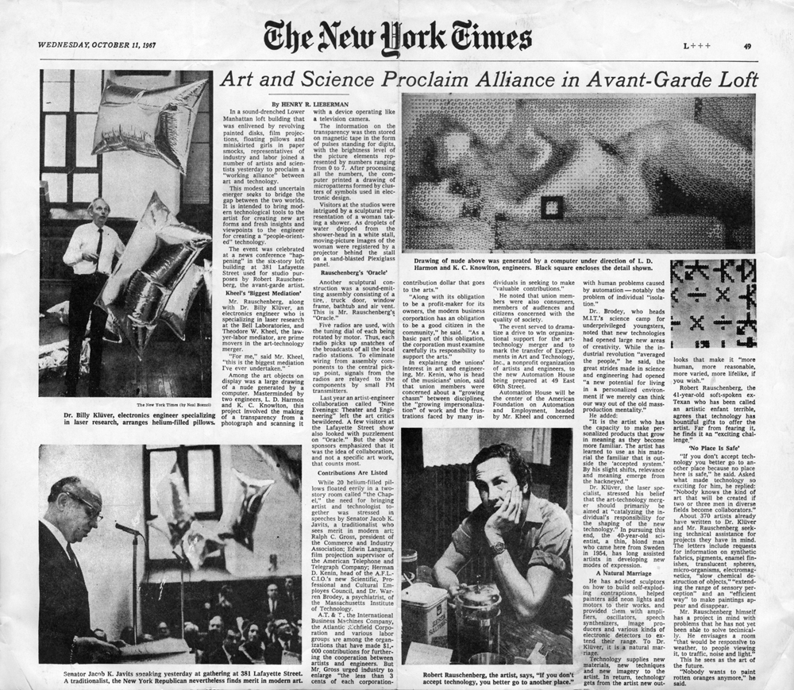
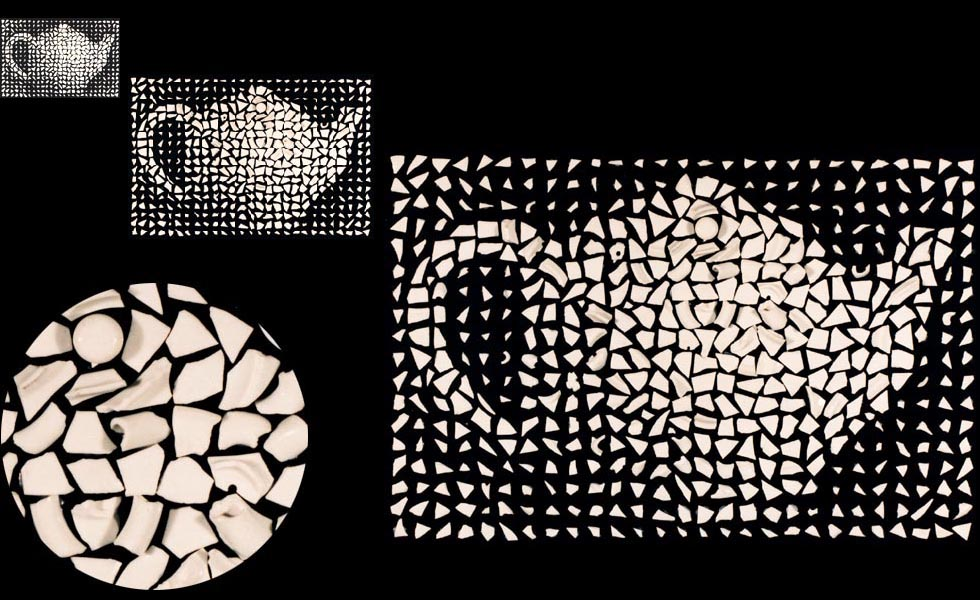
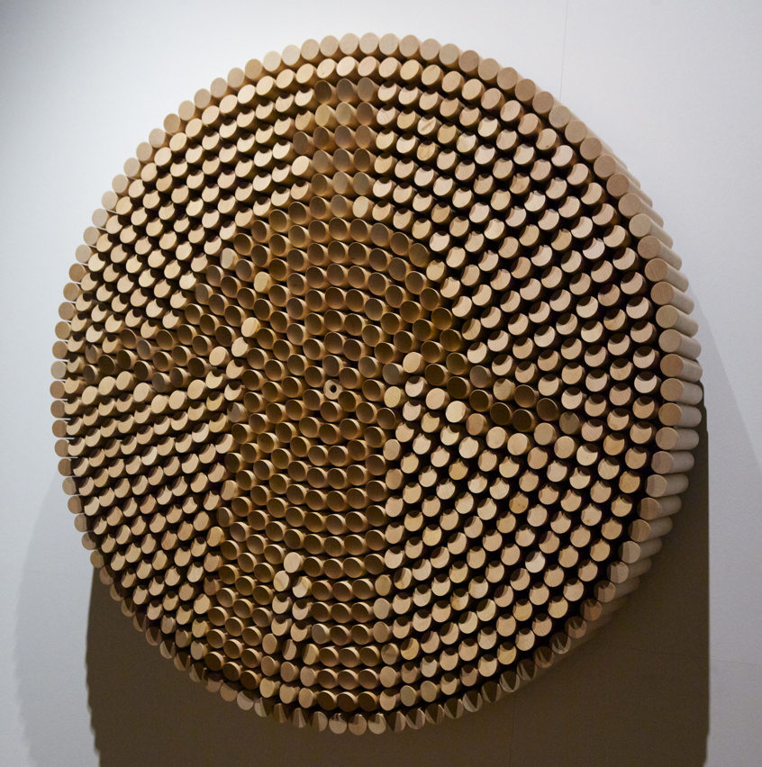
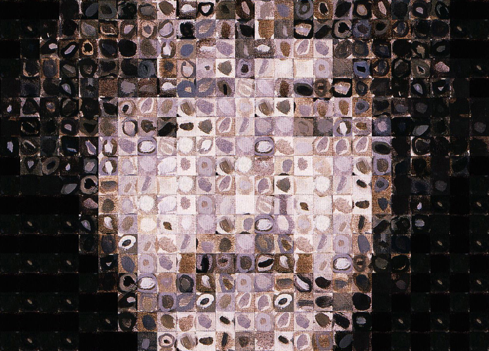
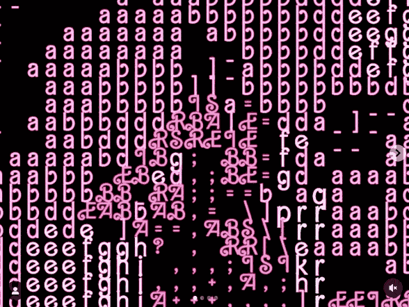
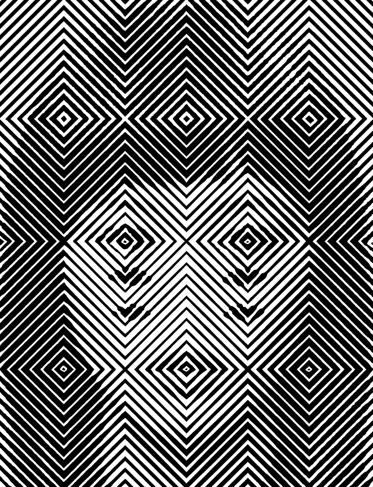
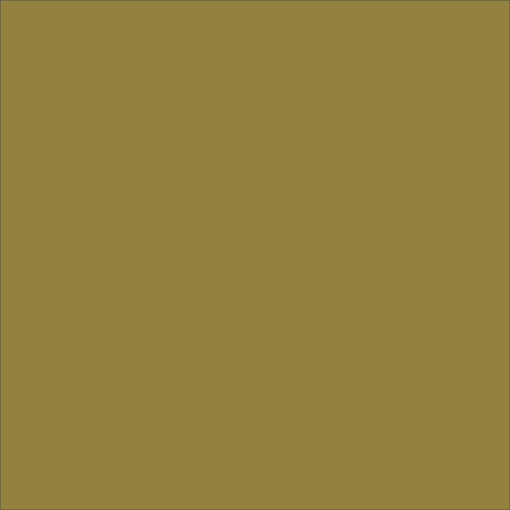

### Custom Pixel Viewings:

Ken Knowlton and Leon Harmon’s "[Studies in Perception #1](https://spalterdigital.com/artworks/nude-3/)" (1966) is a mosaic of small scientific symbols, arranged into a nude. It appeared on the front page of the New York Times in 1967—introducing computer art to a broad American public for the first time. 

Knowlton continued creating computational image mosaics for several decades; he made a [landmark typographic piece](https://spalterdigital.com/artworks/united-nations-declaration-of-human-rights/) (1970), and here's his "This is Not a Teapot" (1998):

**Daniel Rozin** hand-crafts pixels from every material imaginable. His "Peg Mirror" (2007) consists of 650 individually motorized wooden pegs. As they rotate, the pegs catch light, recreating video from a central camera. Check out some of his other creations: [Wooden Mirror](https://vimeopro.com/bitforms/rozin/video/101408845), [Peg Mirror](https://vimeo.com/7709408), [Shiny Balls Mirror](https://vimeo.com/57244184), [Brushed Steel Mirror](https://vimeopro.com/bitforms/rozin/video/57630829), [Weave Mirror](https://vimeopro.com/bitforms/rozin/video/7067089), [Penguins Mirror](https://vimeopro.com/bitforms/rozin/video/129674054), and [plenty more](https://vimeopro.com/bitforms/rozin/page/1).

Scott Blake’s "[Chuck Close Filter](http://www.barcodeart.com/artwork/portraits/chuck_close/index.html)" software (2001) transforms any image into the pixelated style of a Chuck Close painting—using image tiles *extracted from actual Chuck Close paintings*. Following its release, Close threatened Blake with legal action, asserting that the software trivialized his art and threatened his livelihood.

In 2023, Alida Sun published this [dopamine dazzle camouflage](https://www.instagram.com/p/Cwh1qectmVN/?img_index=1) inspired by Eva María Rey Pinto’s research on Mattel’s military alliance:

Image treatment by A.L. Crego (2023). Note the purposeful alignment of facial and geometric features.

What could it mean for your custom pixels to become more "intelligent"? Well, they could be *responsive* to the image content (such as edges, local variance, ...face tracking, etc.). For example, here is a [quadtree-based image filter](https://github.com/fogleman/Quads) by Michael Fogleman, which is responsive to the amount of detail in each region of the image. Fogleman writes: 

> *"Each node in the quadtree is filled in with the average color of its region in the input image. A score is computed for each node based on its mean squared error and its area. The node with the highest error is split into four child nodes. This process is repeated as many times as desired. Detailed regions will be recursively refined while low contrast regions will remain as larger nodes."*

