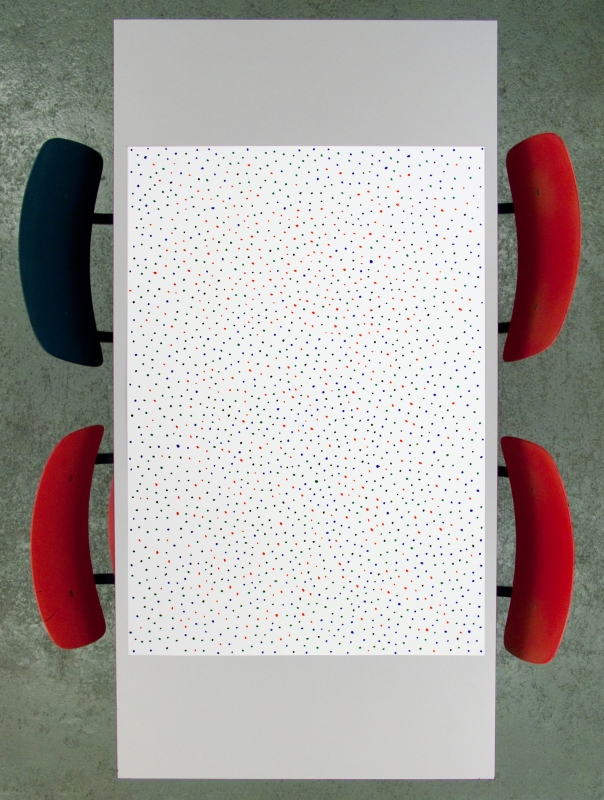
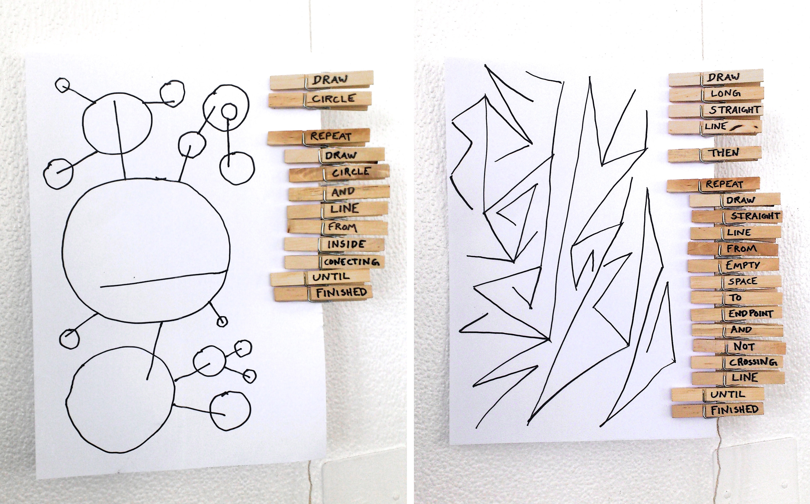
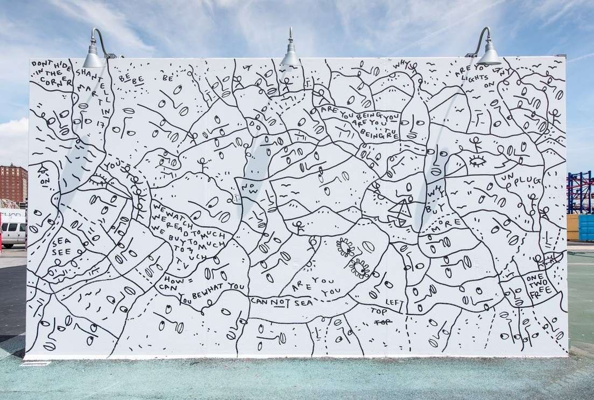

# Wednesday 10/28/2026

---

## Announcements

* **Final project presentations** will be Wednesday, December 9th from 5:30-8pm.
* If you have not already done so, please complete the [Shader Composition Self Assessment form](https://forms.gle/R2p1nHcsNMtra1hU6) during class today.
* The [Pittsburgh Art Book Fair](https://pabf.cargo.site/) is this weekend! It runs 10am-5pm, Saturday and Sunday at the Carnegie Museum of Art. This is a great time to buy and trade zines.

## Agenda

### Shaders & Pixels

* [Custom Pixel](https://openprocessing.org/class/107236/#/c/107956)
* [Shader Composition](https://openprocessing.org/class/107236/#/c/107989)

### The Beach & Poisson Disc Sampling

**Exercise:** This exercise is from the *Conditional Design Manifesto* (2012) by Studio Moniker, which proposes using logic as a "method for accentuating the ungraspable."

* Arrange participants in groups of 3-5 persons per table. Distribute colored pens and a large sheet of paper to each group.
* Each turn, find the most empty space on the paper and place a dot in the middle of it.

<!--  -->

**Viewings:**

* [Video: Mike Bostock on Poisson Disc Sampling](https://vimeo.com/112319901)
* [Demo: Coding Train's Poisson Disc Sampling](https://editor.p5js.org/codingtrain/sketches/4N78DFCXN) (p5)

### Feedback Compositions

* **Introducing [Assignment 7](../assignments/assignment_7_feedback.md) & In-Class Exercises**

### More Viewings *(Time Permitting)*

* [Shantell Martin follows the line](https://www.youtube.com/watch?v=7ywYnk0-xUY) (3 minutes)
* [DLA Wikipedia](https://en.wikipedia.org/wiki/Diffusion-limited_aggregation)
* [DLA Webb](https://github.com/jasonwebb/morphogenesis-resources?tab=readme-ov-file#diffusion-limited-aggregation-dla); [Dendron](https://golanlevin.github.io/dendron/index.html)
* [Diffusion Limited Aggregation (DLA) in p5](https://editor.p5js.org/codingtrain/sketches/XpS9wGkbB)
* [DLA Coral Series by Nervous System](https://n-e-r-v-o-u-s.com/shop/generativeProduct.php?code=9)

