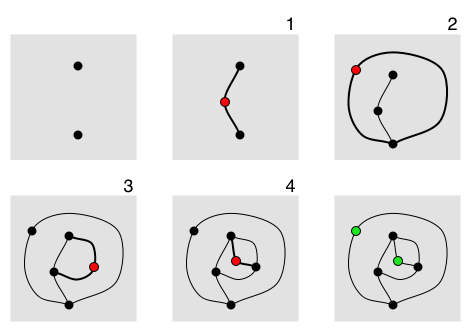

# Monday 11/02/2026

---

## Agenda

* Exercise: *Sprouts* drawing game (below)
* Generative Art (#7.5) shareout
* Presentation: [Emergent form & emergent behavior](../../lectures/emergent_form/README.md)
* Work session for [Assignment 7](../assignments/assignment_7_feedback.md)

---

### Exercise: *Sprouts*

This is [Sprouts](https://en.wikipedia.org/wiki/Sprouts_(game)), a planar graph drawing game. It is demonstrated in [this video](https://www.youtube.com/watch?v=ZQY4v5GItes).

The game is played by two players, starting with a few spots drawn on a sheet of paper. Players take turns, where each turn consists of drawing a line between two spots (or from a spot to itself) and adding a new spot somewhere along the line. The players are constrained by the following rules:

* The line may be straight or curved, but must not touch or cross itself or any other line.
* The new spot cannot be placed on top of one of the endpoints of the new line. Thus the new spot splits the line into two shorter lines.
* No spot may have more than three lines attached to it. For the purposes of this rule, a line from the spot to itself counts as two attached lines and new spots are counted as having two lines already attached to them.

---