# Repetition, Replication, and the Afterlife of Form

**Libby McCaffrey, TA** **60-212 • Creative Coding**

  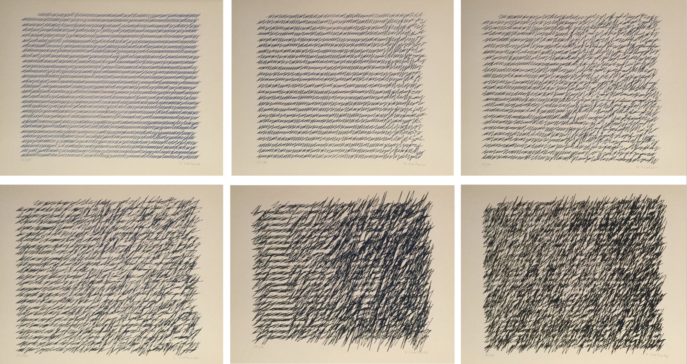
   
  Vera Molnár 
  <em>Lettres de ma Mère</em>, 1990

# Overview

This session looks at the history of computational art through the lens of repetition: which visual forms survive as they are copied, recoded, and remixed over time, and what gets lost along the way.

Today images are shared constantly and increasingly generated with AI tools. In that flood of transmission, attribution and the physical histories of objects get abstracted and deformed, and parts of our digital culture disappear. Understanding how computational forms have traveled and changed lets us approach our own work with more care for the pioneers who came before us, how we use their forms, and what those forms mean for the history of computer-based art.

**Guiding question:** *When a visual form gets repeated, what survives, and what gets lost?*

### Session structure

1. **Lecture:** theory of visual transmission (Warburg, Kubler) applied to computer art history
2. **Discussion:** assigned reading
3. **Activity:** recreating early computer art and building a shared lineage board

### Reading

**Assigned reading:** [The Shape of Time, George Kubler 1962](https://monoskop.org/images/8/87/Kubler_George_The_Shape_of_Time_Remarks_on_the_History_of_Things.pdf)

Please read the *Preamble: Symbol, Form, and Duration* (pp. vii-ix) & *Replication: Permanence and Change* (pp. 71-72)

I understand the prose may be more challenging than contemporary writing however you will only be reading 5 pages. I've purposely assigned limited sections so you can try your best to digest and understand its contents. Please try your best and we will unpack the ideas more in class! We will have a small discussion so it is important to form your own thoughts on the subject matter.

# Lecture

### 1. Introduction & background

  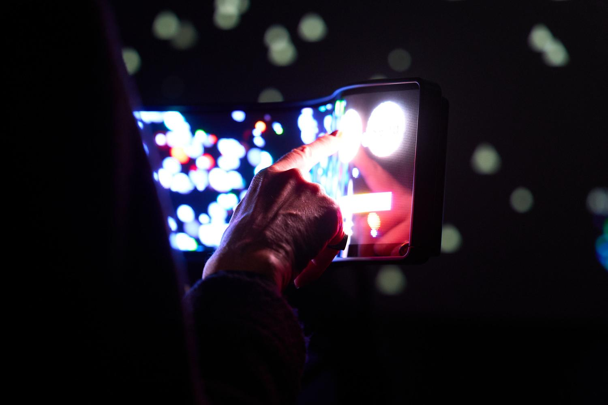
   
  Elizabeth McCaffrey, Chloe Hudson Prock with Jasmine Yiming Sun &amp; Paolo Ciuccirelli 
  <em>Our Energy Nexus</em>, 2026

A quick look at my path and current work:

- **Education:** B.Sc. Computer Science & Design at Northeastern (2021–2025); M.Sc. Computational Design at CMU
- **Research:** Data Visualization Specialist & Research Fellow @ MIT Senseable City Lab
- **Selected projects:** *Displacement Flowers* (IEEE VISAP 2024), *Our Energy Nexus* (Milan Design Week 2025), *A Typology of Looking* (Experimental Capture 2026), *Sketchpad Reconstruction* (CodeLab 2026)

I make immersive and interactive data experiences that communicate complex ideas, with a focus on interaction and responsiveness. Right now I'm working with eye tracking as a creative medium and helping reconstruct Sketchpad (1963), the earliest CAD system. My research interest is **computational art history**: how early computational forms developed, how they survive in our visual culture, and how to design experiences that carry that history forward.

### 2. Opening: three images, three lineages

  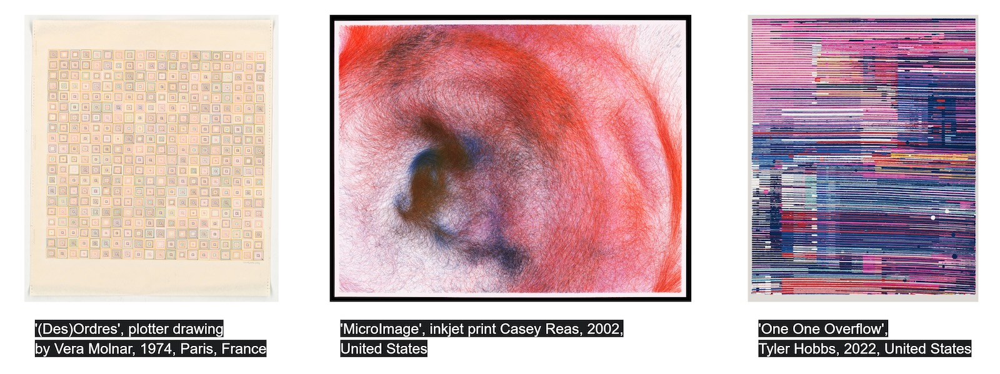

These works span early and contemporary computational art. Each has a lineage that isn't visible in its form alone. Even when a form is familiar, computational art often struggles with authorship and attribution, which is one of the central questions of my research.

### 3. Theory: Aby Warburg and the afterlife of images

  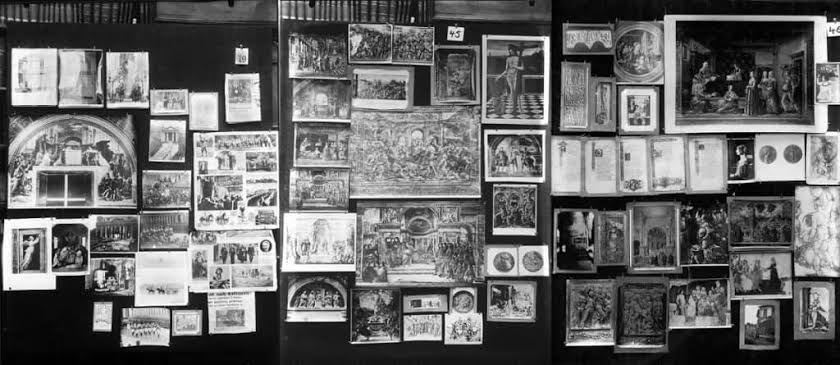
   
  Aby Warburg 
  <em>Mnemosyne Atlas</em>, Panels 19, 45, and 48, 1925–1929

Aby Warburg (1866–1929) pioneered a mode of art-historical research built on visually arranging repeating forms and symbols across history, rather than grouping works by period or medium.

- **Afterlife (*Nachleben*):** images don't die with their period. They replicate and reappear throughout history.
- **Pathos formula (*Pathosformel*):** emotionally charged, compelling forms are the ones that survive, so what repeats is culturally significant.
- **Arrangement as inquiry:** placing images side by side is itself the research, not just a presentation of conclusions.

Applied to computer art, this lets us ask which algorithms, forms, and compositions survive, and why.

### 4. Theory: George Kubler and formal sequences

  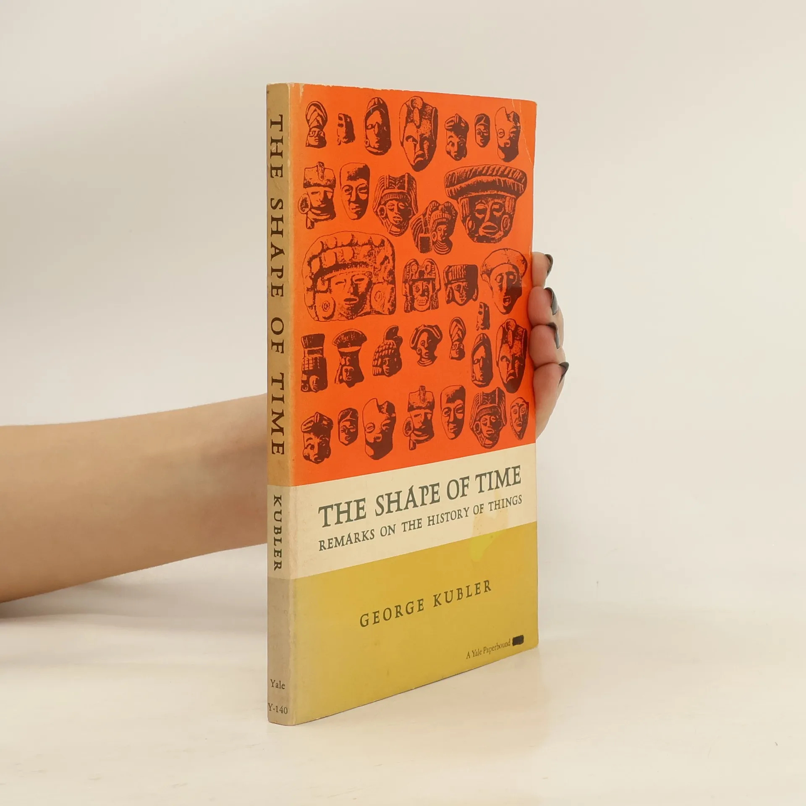
   
  George Kubler 
  <em>The Shape of Time</em>, 1962

George Kubler (1912–1996), in *The Shape of Time* (1962), also refused to confine objects to a single period. He treated them as sequences of things and ideas that repeat and reappear.

- **Prime object:** a form so influential that it carries forward through many repetitions.
- **Formal sequence:** by identifying the sequence a set of repetitions belongs to, we can move from unrelated copies to an ordered picture of how a form developed.

**Why it matters:** these methods let us consider visual objects in their full context, as relations to earlier expressions rather than fixed points in history. Computer art is a clear sequence of forms, which makes it an ideal candidate for this kind of analysis.

**The limitation:** both frameworks value the *form* over the *individual*. My methodology aims to analyze formal progressions *and* the people behind them.

### 5. Method as prime object: Vera Molnar

<table>
  <tr>
    <td align="center" valign="top" width="50%">
      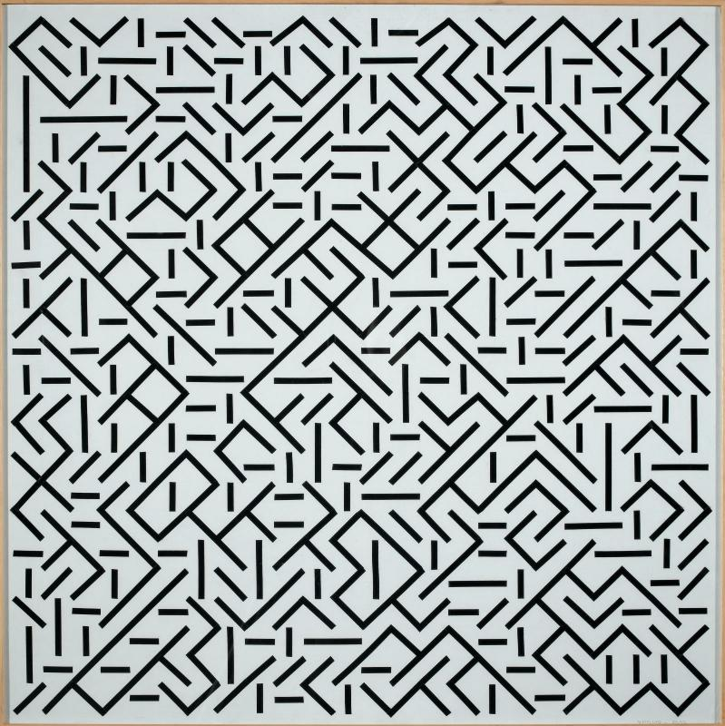 
      (Before plotter) 
      Vera Molnár 
      <em>Quatre Éléments Distribués au Hasard</em>, 1959
    </td>
    <td align="center" valign="top" width="50%">
      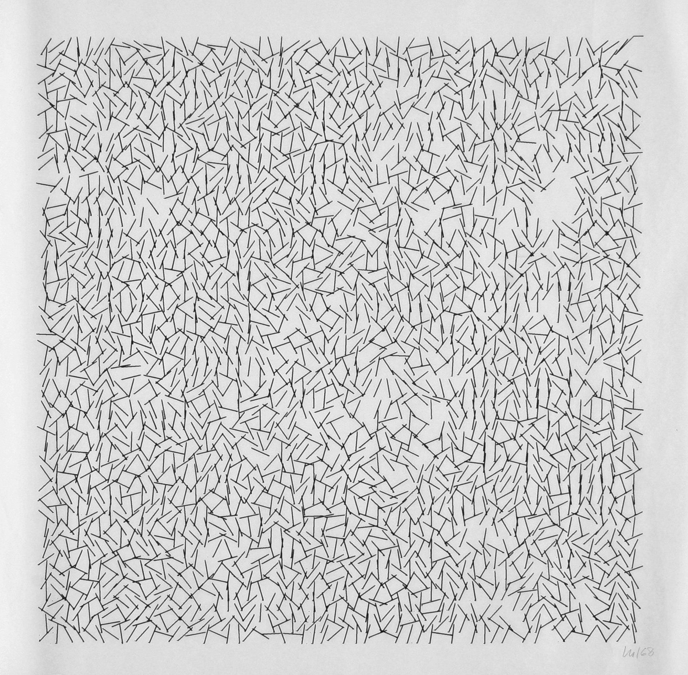 
      (With plotter) 
      Vera Molnár 
      <em>Interruptions</em>, 1969
    </td>
  </tr>
</table>

Before she had access to a computer, Molnar worked with her *machine imaginaire*: rule-based procedures carried out by hand. She later used code to create generative work drawn with pen plotters.

**Takeaway:** the prime object may be the *system*, not any single image. Algorithmic thinking isn't tied to an individual or a machine; it's a way of thinking.

### 6. Replication and preservation: Sketchpad

  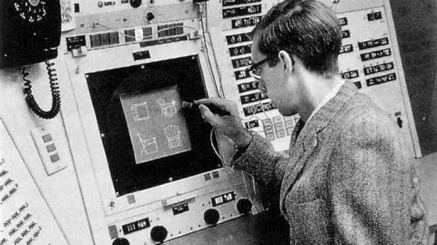
   
  Ivan Sutherland, later extended by Timothy Johnson 
  <em>Sketchpad</em>, 1963

[**Sketchpad**](https://www.youtube.com/watch?v=6orsmFndx_o&t=270s) (video) was the first computer-aided design (CAD) system and one of the first times anyone could draw directly on a computer. Replication was built into it: it introduced **instancing**, where changing a master shape updated every copy, similar to objects in modern object-oriented design programming.

The system is sparsely documented and the original TX-2 computer no longer exists, so some of the most important early innovations in computer graphics have been lost. Our lab is reconstructing the software and workspace to recover this part of computer art history.

### 7. Replication and afterlife: Noll and Schwartz

<table>
  <tr>
    <td colspan="2" align="center">
      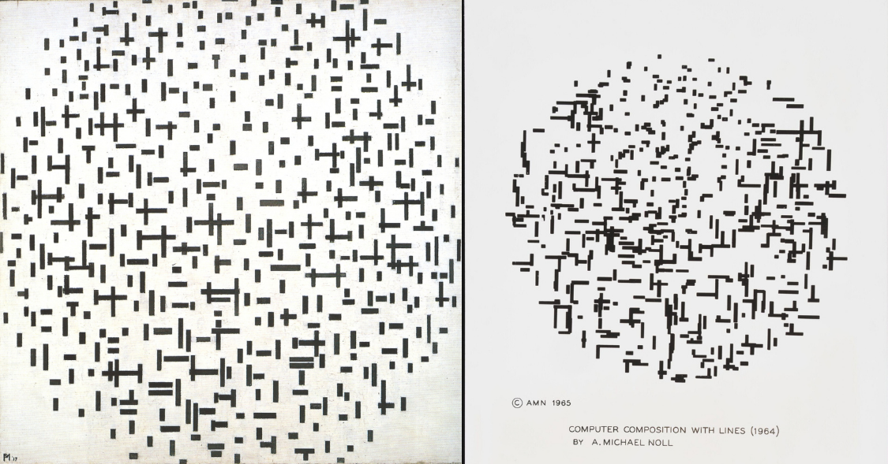
    </td>
  </tr>
  <tr>
    <td align="center" valign="top" width="50%">Piet Mondrian <em>Composition with Lines</em>, 1917</td>
    <td align="center" valign="top" width="50%">A. Michael Noll <em>Computer Composition with Lines</em>, 1964</td>
  </tr>
</table>

Noll recreated a Mondrian computationally. When viewers were asked which they preferred, many chose the computer version: **a replication outshining its prime object.** Whose name is now most associated with the form, and which work is the precedent? The experiment also reflects a long-running drive to recreate images computationally, from computer graphics to diffusion models, and raises questions about how people respond to AI-generated images compared with their sources.

  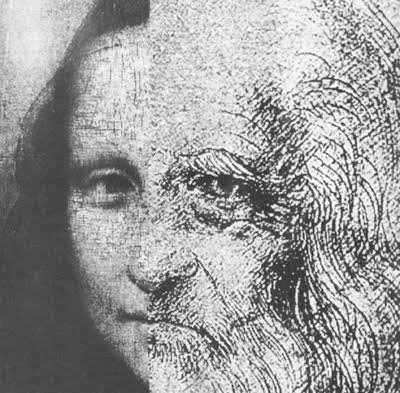
   
  Lillian Schwartz 
  <em>Mona/Leo</em>, 1987

Schwartz used computation to juxtapose elements of classical art history. In Warburg's terms, this work belongs to the *Mona Lisa's* afterlife even though it has no relationship to its period. Computers serve as devices of replication for algorithmic forms and classical artworks alike.

### 8. Formal sequence: Georg Nees's *Schotter*

  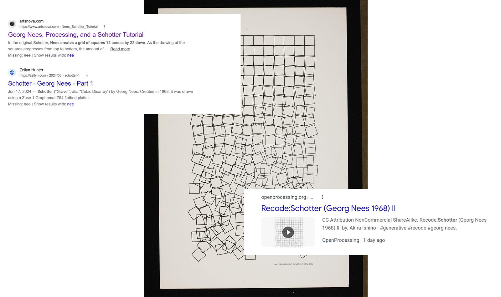
   
  Georg Nees 
  <em>Schotter</em>, 1968, and recreations

*Schotter* has become one of the classic creative coding exercises, with countless tutorials and recodes online. Each tries to understand the underlying structure and teach how algorithmic processes work.

That sea of recreations forms a **formal sequence** that starts from the prime object. Following it, we can ask how the form and its implementation change, and which elements matter. The form is universally recognizable, but is the artist?

### 9. Implications: late in the sequence

<table>
  <tr>
    <td align="center" valign="top" width="50%">
      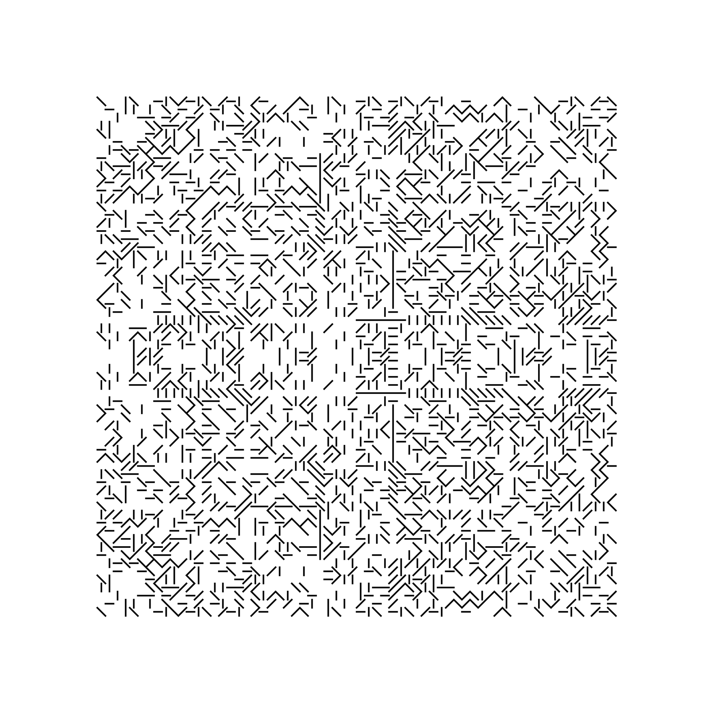 
      Matt Hall &amp; John Watkins 
      <em>Autoglyphs</em> (NFT), 2019
    </td>
    <td align="center" valign="top" width="50%">
       
      Vera Molnár 
      <em>Interruptions</em>, 1969
    </td>
  </tr>
</table>

This NFT uses the disordered-grid logic found throughout Molnar's work. In an interview, its creators cite early digital art of the 1960s and '70s ([Interview](https://www.artnome.com/news/2019/4/08/autoglyphs-generative-art-born-on-the-blockchain)), but name only Noll and LeWitt. It's a clear example of whose contributions get recognized, and of why more education about the history of these forms is needed.

In Kubler's terms, these works enter **late in the formal sequence**. In an age when media is everywhere and copying is pervasive, we need an understanding of our cultural memory more than ever.

> **Computational art history should trace forms and keep the names attached. Tools that track sequences can also track credit.**

# Discussion

> Every time you write a loop or remix a sketch you're joining a lineage of forms. Understanding how those forms travel, and why their makers' names fall away, lets you make work that knows where it comes from and keeps the people who shaped it from disappearing.

<!-- Add discussion prompts or notes from the session here -->

# Activity: Recreation

<table>
  <tr>
    <td align="center" valign="top" width="33%">
      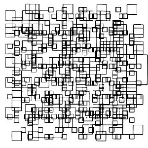 
      Charles Csuri 
      <em>Random Squares</em>, 1976
    </td>
    <td align="center" valign="top" width="33%">
      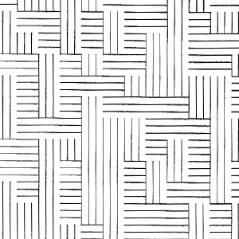 
      Reiner Schneeberger 
      <em>Untitled 5</em>, 1978
    </td>
    <td align="center" valign="top" width="33%">
      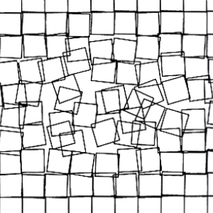 
      William Kolomyjec 
      <em>Boxes I</em>, 1977
    </td>
  </tr>
</table>

Students recreate a work of early computer art from the image alone, reverse-engineering its system in code, then introduce a deliberate variation so their version becomes a new link in the work's formal sequence. All outputs go onto a shared board and are arranged by lineage, from source work outward, with attribution carried alongside each piece.

> **Code reference solutions:** [Random Squares](https://recodeproject.com/translations/chris-allick-direct-random-squares-charles-csuri) · [Untitled 5](https://recodeproject.com/translations/jon-bobrow-direct-untitled-5-reiner-schneeberger) · [Boxes I](https://recodeproject.com/translations/sermad-buni-direct-boxes-i-william-kolomyjec)

### Links

**Miro board:** [Link](https://miro.com/app/board/uXjVENl1olw=/?share_link_id=392966293706) 
The shared lineage board where the class's recreations and variations are arranged around their source works.

**ReCode Project:** [Link](https://recodeproject.com/) 
A community archive of early computer artworks, many originally published in the journal *Computer Graphics and Art* in the 1970s, recoded in Processing and shared openly. It's both a source for the works in this activity and a living example of a formal sequence of recreations.
