# Emergent Form / Emergent Behavior

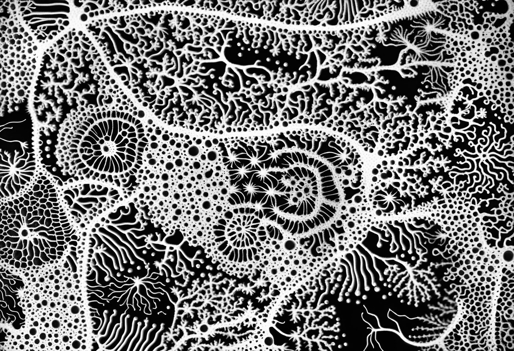 *Work by Colin Reid combining reaction-diffusion and DLA.*

> **Emergence** describes how complex patterns, structures, and behaviors can arise from simple rules and local interactions, without a central plan. In this lecture, we'll explore how *feedback* allows a system's evolving state to influence what happens next, producing forms and behaviors that aren't explicitly specified by its rules.

---

## Drawing as a *Sequence of Decisions* 

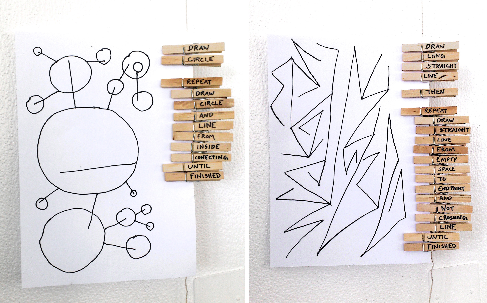

In rule-based drawing, an artwork can emerge from a sequence of simple decisions rather than a predetermined composition. Each decision produces a mark, which may influence the decisions that follow.

When each new mark responds to what has already been drawn, the drawing becomes a feedback system. Complex patterns and unexpected compositions can emerge from surprisingly simple instructions, without anyone planning the final result.

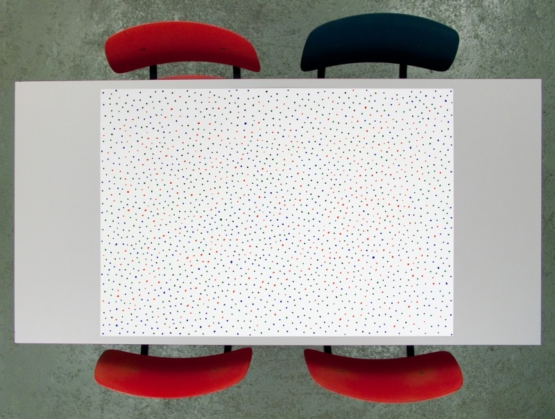

Recall how in the Conditional Design *Beach* exercise, each new dot is placed in the largest remaining empty space. Every dot changes the available space, influencing where the next dot will be placed. An even distribution emerges without anyone specifying a grid.

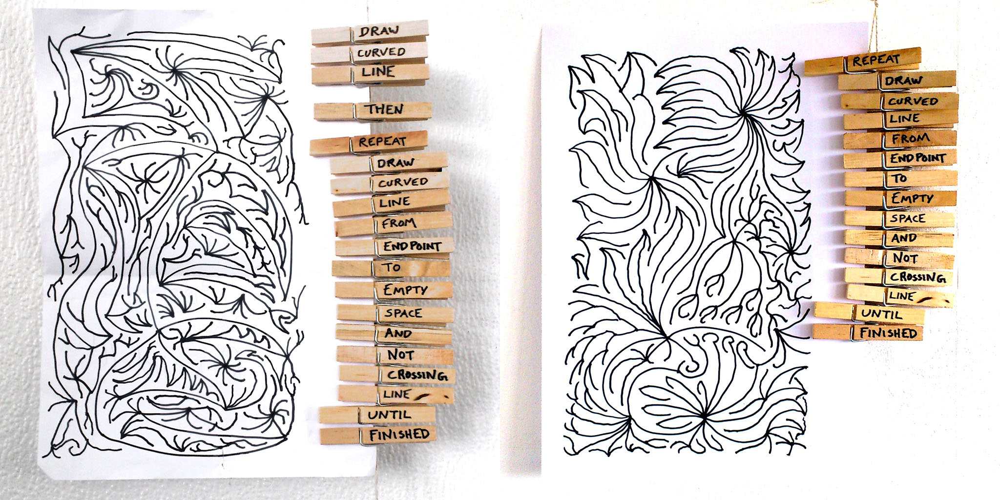 
*Peg Programming* by Ed Burton (~2010)

Some other approaches to consider: 

* **Density balancing:** Repeatedly identify the least-dense region and add marks there.
* **Recursive partitioning:** Repeatedly subdivide the largest remaining region.

---

# Morphogenetic Simulation

**Morphogenetic simulations** explore how complex forms emerge from simple interactions, often inspired by physical forces and processes observed in nature. By modeling these interactions with computational rules and adjustable parameters, we can investigate how growth, movement, and feedback give rise to organic structures and patterns. This section considers several different kinds of simulations — (there are many others):

* Ice-Ray Grammars
* Desire Paths & Physarum (Slime Mold)
* Flocking (Boids) Simulation
* Diffusion-Limited Aggregation (DLA)
* Space Colonization (Leaf Venation)
* Differential Growth

---

## Ice-Ray Grammars

We considered Ice-Ray grammars when we studied Jared Tarbell's [*Substrate*](img/jared_tarbell_substrate.jpg) (2003). 

**Feedback:** a line propagates until it hits a previous line, while sometimes branching off new lines. Existing lines determine where subsequent lines stop, intersect, or branch.

How does it work?

1. A line begins growing from a starting point in a particular direction.
2. As it grows, it checks whether it has encountered an existing line.
3. When it reaches another line, it stops growing.
4. New lines may branch off from existing lines, often at specified angles.
5. As the network grows, it creates more boundaries and opportunities for subsequent lines to intersect or branch.

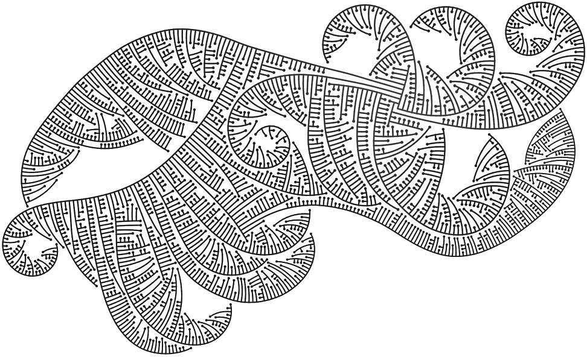 Mitchell Whitelaw, [*Limits to Growth*](https://mtchl.net/limits-to-growth/), 2008

Shantell Martin uses something like an ice-ray grammar in structuring her improvisatory wall drawings: 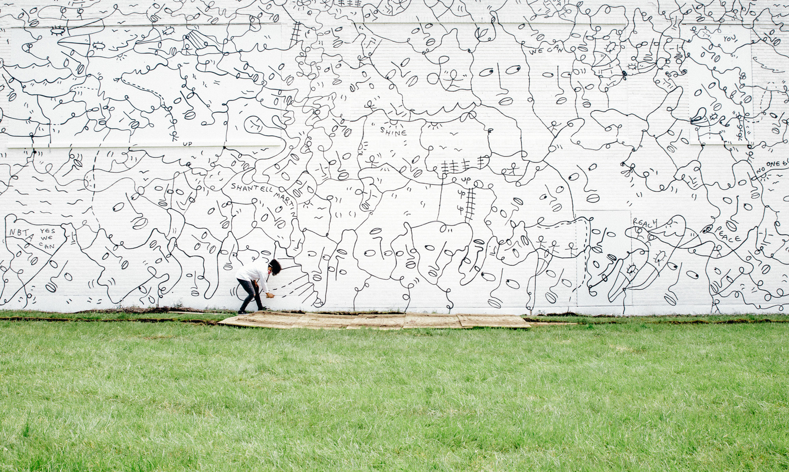

---

## Desire Paths & Physarum (Slime Mold)

A "desire path" emerges from many individual decisions, without anyone planning it. 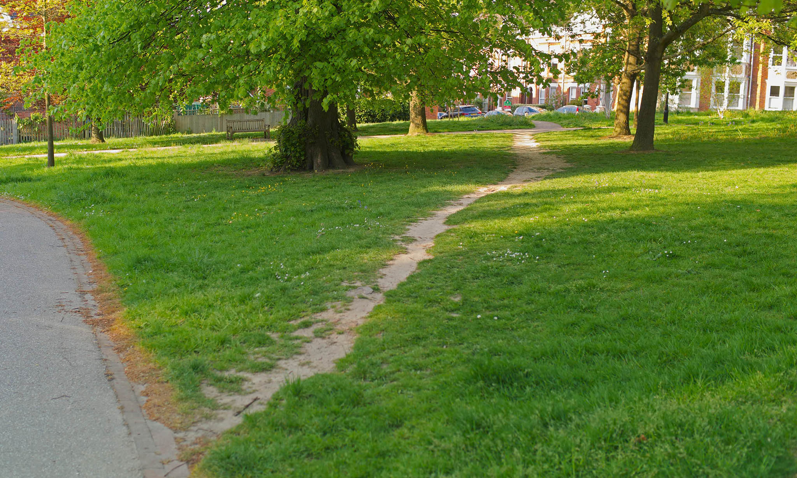

How does it work?

**Feedback:** People are more likely to walk where others have already walked.

1. To get to a common destination, people take shortcuts across grass, gradually wearing it down.
2. The worn areas become easier to walk on, with less vegetation in the way, and the ground more compacted.
3. Subsequent pedestrians are more likely to follow these emerging paths.
4. Increased foot traffic wears the paths down further, making them even more attractive. This is <em>positive feedback</em>, or reinforcement.

A similar mechanism underlies the growth of *Physarum* simulations, which model the emergent behavior of slime mold using thousands of simple moving agents. Each agent deposits a chemical "pheromone" trail and senses the trails left by other agents, preferentially moving toward stronger concentrations.

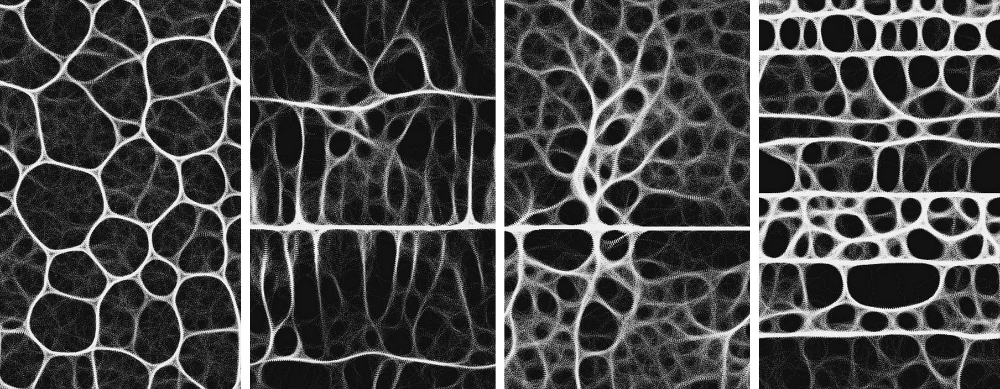

**Feedback:** Agents create trails that influence the movements of subsequent agents, which reinforce or modify those trails.

Three parameters influence each agent's behavior:

- **Sensor Angle:** How wide a field an agent's forward-facing sensor can sense.
- **Sensor Range:** How far ahead the agent samples the chemical trail.
- **Step Size:** How far the agent moves on each step.

The chemical trails gradually diffuse (blur) and fade. As agents follow and reinforce one another's trails, patterns emerge without any centralized control.

* Sage Jenson, [36 Points](https://www.sagejenson.com/36points/) (artwork)
* Deniz Bicer, [Understanding the Physarum Simulation](https://denizbicer.com/202408-UnderstandingPhysarum.html) (explainer)
* Jason Webb, [Physarum](https://github.com/jasonwebb/morphogenesis-resources?tab=readme-ov-file#physarum) (list of resources)

---

## Flocking (Boids) Simulation

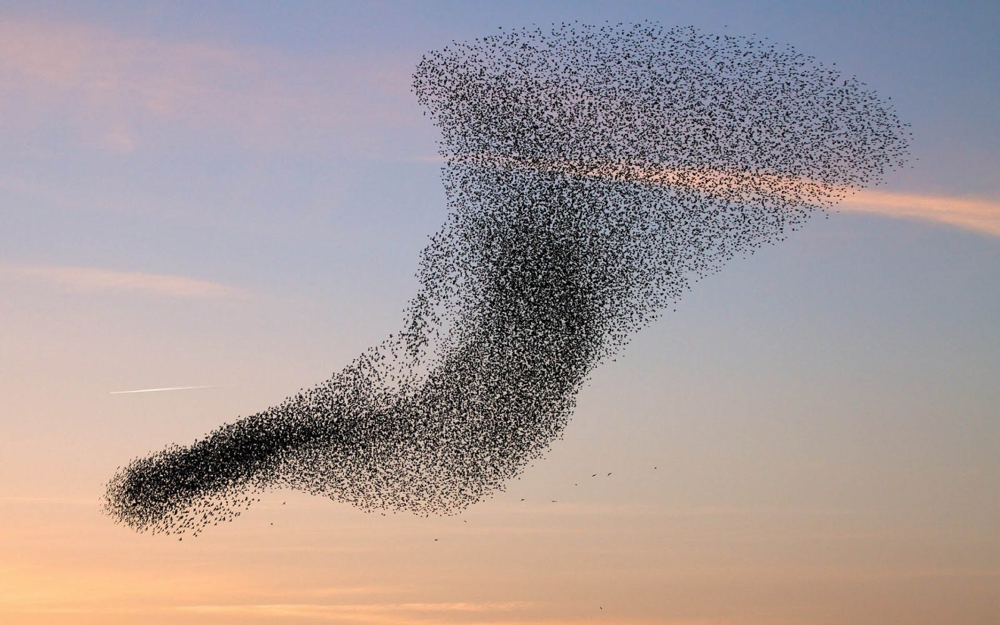

In a flocking simulation, many independent agents move according to simple rules that respond to the positions and movements of their neighbors. Together, they produce coordinated motion without any leader directing the flock.

* [p5 Flocking demo](https://editor.p5js.org/golan/sketches/QT_Ie350R)

**Feedback:** Each agent changes its movement in response to nearby agents, whose movements are also changing in response to their neighbors.

How does it work?

1. Each agent observes the positions and directions of nearby agents.
2. It adjusts its movement to avoid crowding, align with its neighbors, and stay near the group.
3. These adjustments change the agent's position and direction.
4. Neighboring agents respond to these changes, influencing one another continuously.
5. Coordinated patterns of movement emerge from these ongoing local interactions.

In many flocking simulations, three parameters influence each agent's behavior:

- **Separation:** How much distance each agent prefers to maintain to its neighbors. 
- **Alignment:** The extent to which agents turn to face the same direction as their neighbors.
- **Cohesion:** The extent to which agents seek the centroid of their neighbors.

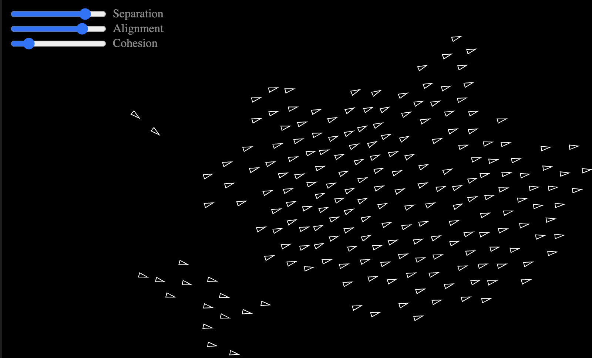

Note that a Boids flock does not ordinarily remember its accumulated history. Its feedback comes from the changing state of neighboring agents, not persistent marks. This makes it a good example of emergent *behavior*, but not a direct model for the feedback-drawing assignment.

---

## Diffusion-Limited Aggregation (DLA)

The shapes of these metal crystals emerge from a process like diffusion-limited aggregation (DLA). 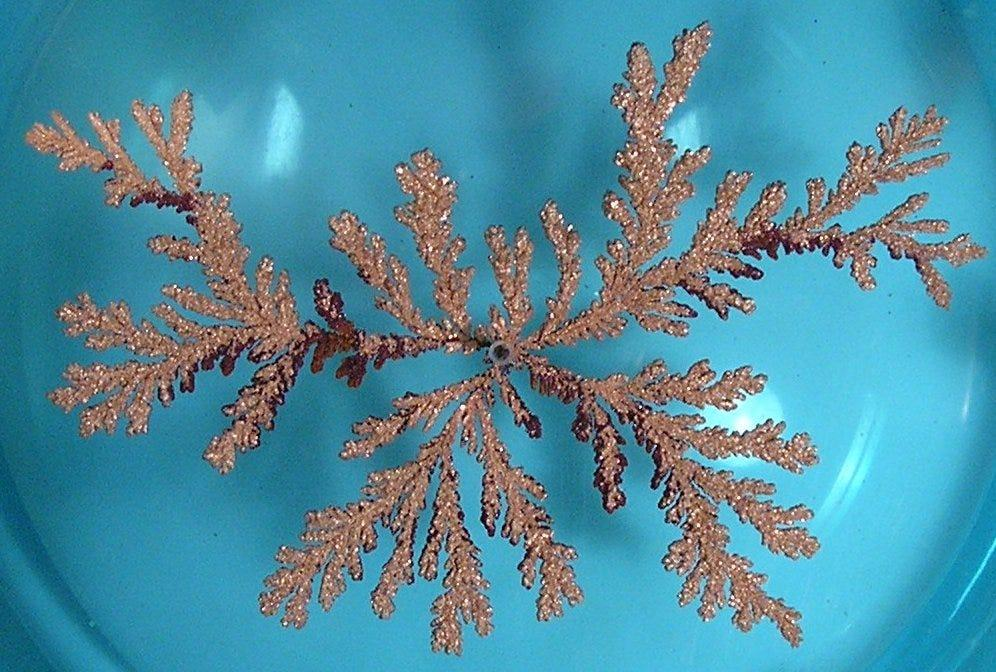

**Feedback:** The existing shape of the deposit influences where new material arrives, which changes the shape of the deposit. Particles get stuck to previous particles.

How does it work?

1. Particles (dissolved ions) move through a solution toward a growing deposit.
2. Particles arriving at the deposit's surface stick to it, adding more material.
3. Small protrusions on the deposit extend farther into the surrounding solution, where they have better access to incoming particles.
4. These protrusions grow preferentially, while recessed regions receive fewer ions.
5. The resulting branches extend and subdivide, producing a dendritic structure.

This desktop experiment with castor oil shows the principle at macro-scale: 

And here are some DLA simulations in p5: 
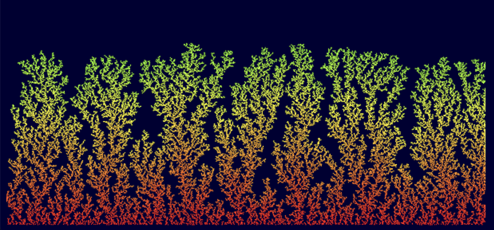

* [Raster DLA Demo by Golan](https://editor.p5js.org/golan/sketches/GVMtuNn12)
* [DLA Demo by Coding Train](https://editor.p5js.org/codingtrain/sketches/XpS9wGkbB)

*Other references:*

* [Jewelry by Nervous System](https://n-e-r-v-o-u-s.com/shop/generativeProduct.php?code=9) (artwork)
* [Prusinkiewicz on DLA](http://algorithmicbotany.org/vmm-deluxe/Section-05.html) (article)
* [Paul Bourke on DLA](https://paulbourke.net/fractals/dla/) (article)
* [Coding Train on DLA](https://www.youtube.com/watch?v=Cl_Gjj80gPE) (tutorial)

---

## Space Colonization (Leaf Venation)

Space colonization is an algorithm for growing branching structures, inspired by processes such as the development of leaf veins. A network of branches grows toward a collection of attractor points, which are gradually removed as the branches reach them.

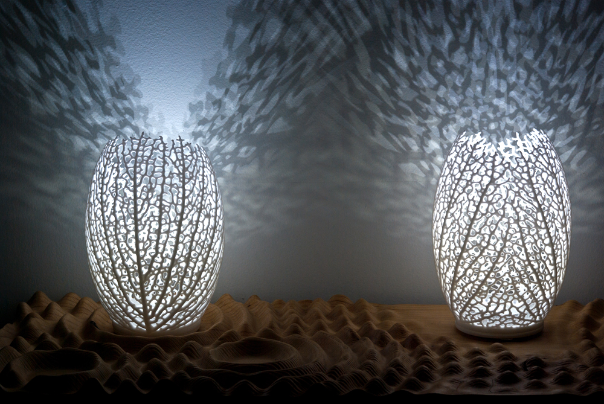

**Feedback:** The growing branches change which attractors remain available, and the remaining attractors determine where subsequent branches grow.

How does it work?

1. Distribute attractor points throughout a region where branches may grow.
2. Existing branches grow toward nearby attractors.
3. When a branch reaches an attractor, that attractor is removed.
4. As the network expands, the remaining attractors influence which branches grow and in which directions.
5. This process repeats until the attractors have been reached or no further growth is possible.

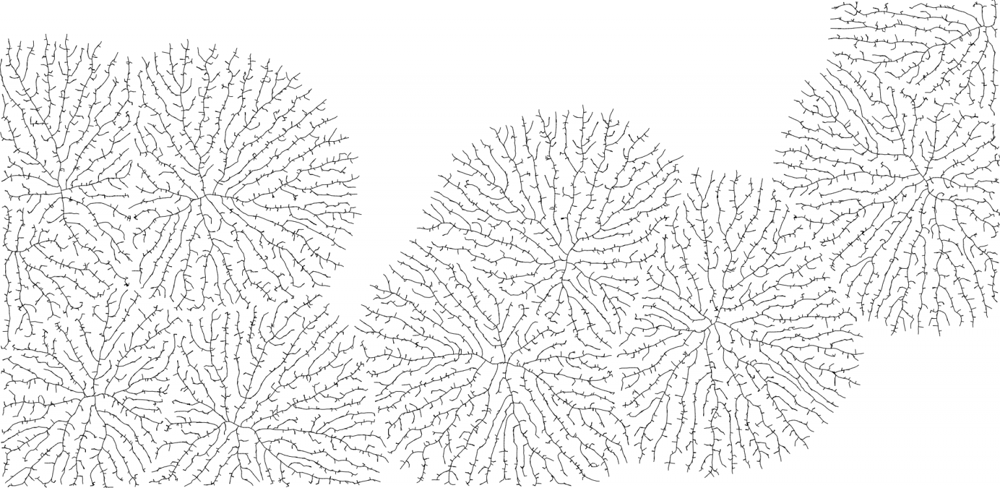

1. **Place** a set of attractors (the teal dots in the diagram below).
2. For each node (black dot), **determine** which attractors are influencing it, based on some distance threshold.
3. For each node, **calculate** the average direction towards all of the attractors influencing it.
4. **Calculate** positions for *new* nodes by normalizing this average direction to a unit vector, then scaling it by a pre-defined segment length.
5. **Place** new nodes at the calculated positions.
6. **Check** if any nodes are inside any attractors’ kill zones.
7. **Prune** attractors when nodes get too close.
8. **Repeat** the process over again from step (2).

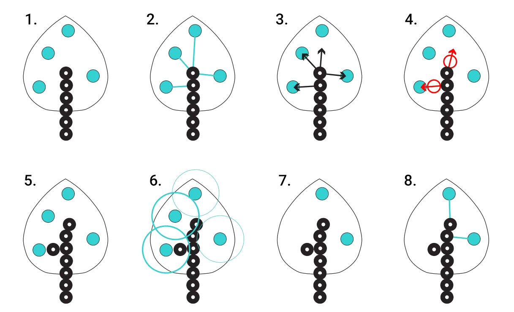

There are several key parameters that affect the character of the resulting leaf branches.

* **Attraction distance:** only nodes within this distance around an attractor can be associated with that attractor. Large attraction distances mean smoother and more subtle branch curves, but at a performance cost.
* **Kill distance:** an attractor may be removed if one or more nodes are within this distance around it.
* **Segment length:** the distance between nodes as the network grows. Larger values mean faster growth, but choppier and sharper branch curves.

Viewings:

* Nervous System, [Hyphae Lamps](https://n-e-r-v-o-u-s.com/blog/?p=1701) (artwork & explainer)
* Jason Webb, [Venation/Colonization](https://medium.com/@jason.webb/space-colonization-algorithm-in-javascript-6f683b743dc5) (article & explainer)
* Coding Train, [Space Colonization](https://www.youtube.com/watch?v=kKT0v3qhIQY) (tutorial)

---

## Differential Growth

Differential growth is a process in which different parts of a shape grow and deform in response to one another. When a line or boundary grows faster than it can spread outward, it may buckle, fold, and develop increasingly intricate wrinkles.

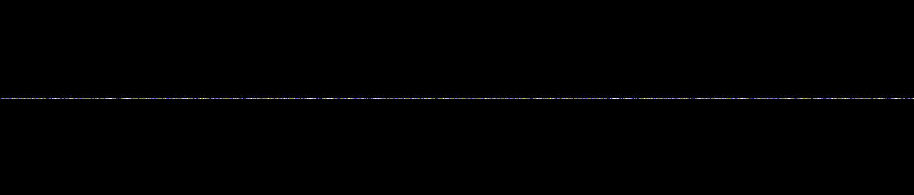

* Jason Webb, [Differential Growth Playground](https://jasonwebb.github.io/2d-differential-growth-experiments/experiments/playground/) (interactive)
* Jason Webb, [Exploring 2D differential growth with JavaScript](https://medium.com/@jason.webb/2d-differential-growth-in-js-1843fd51b0ce) (article)
* Anders Hoff, [Shepherding Random Growth](https://inconvergent.net/2016/shepherding-random-growth/) (article)
* Patt Vira, [Differential Growth in p5](https://www.youtube.com/watch?v=1viK2qKuP-Y) (tutorial)
* Joshua Bagley, [Mister Shifty and the Drifty Dudes](https://verse.works/series/mister-shifty-and-the-drifty-dudes-by-joshua-bagley) (artwork)
* [Simple differential growth in p5](https://editor.p5js.org/golan/sketches/CDtgcavMK) (demo)

**Feedback:** As a curve grows, its existing folds repel nearby segments, forcing the growing curve to bend and fold in new directions.

How does it work?

1. Begin with a curve represented by a sequence of connected points.
2. Increase the spacing between existing points to make the curve grow. When the distance between neighboring points exceeds some threshold, introduce new intermediate points.
3. Nearby points repel one another, preventing different parts of the curve from getting too close.
4. Connected points attract or align with their neighbors, keeping the curve relatively smooth and continuous.
5. These competing forces cause the growing curve to buckle and fold. The resulting folds influence how the curve continues to grow.

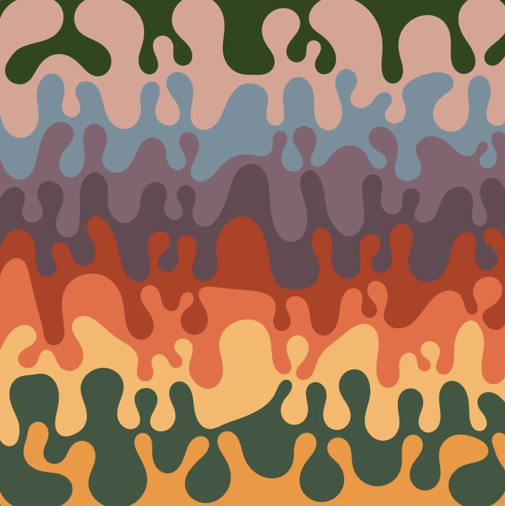 Joshua Bagley, 2024

---

## Additional Morphogenesis Resources

Resources surveying a wide variety of algorithms for growing forms.

* [*Morphogenesis Resources*](https://github.com/jasonwebb/morphogenesis-resources) by Jason Webb
* [*Algorithmic Botany papers*](http://algorithmicbotany.org/papers/#webdocs) and [Visual Models of Morphogenesis](http://algorithmicbotany.org/vmm-deluxe/TableOfContents.html) by Przemyslaw Prusinkiewicz 

<!-- 
// Commented out for now
### Sand Dunes

Sand dunes emerge from interactions between wind and the changing surface of the land. 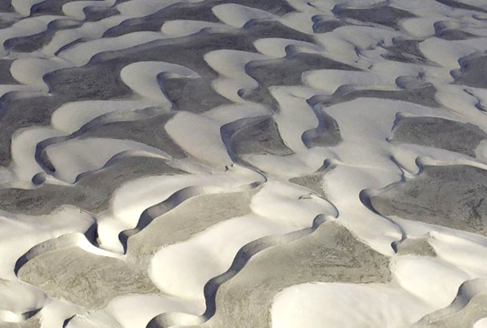

How does it work?

**Feedback:** The shape of the sand changes where wind deposits more sand.

1. Wind blows sand across a surface containing small bumps and irregularities.
2. Each bump creates a sheltered region on its downwind side, where wind-blown sand is more likely to settle.
3. As sand accumulates, the bump grows larger, creating a larger obstacle that can trap additional sand.
4. Wind carries sand up the gently sloping, windward side. Sand deposited near the crest eventually avalanches down the steeper, downwind side.
5. This process repeats: the growing dune changes where sand is deposited, while sand is continually transported from its windward side to its downwind side.

This simulation shows dune formation and propagation: 

---
-->

<!--
// Commented out for now
### Mud Cracks

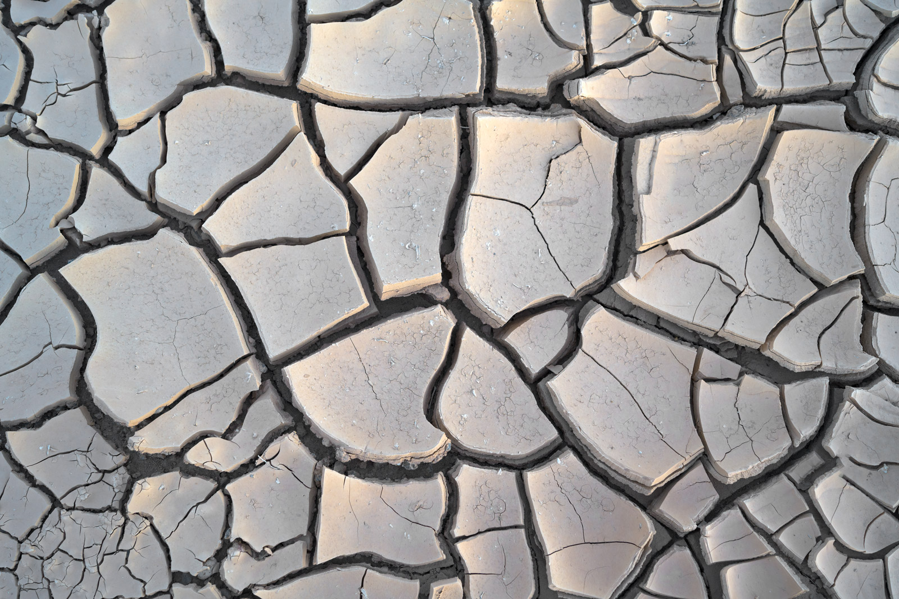

Existing cracks change where the mud experiences stress, influencing where new cracks form. Result: A network of polygons emerges without any predetermined plan for their shapes or sizes.

How does it work?

**Feedback:** Existing cracks change where the mud experiences stress, influencing where new cracks form.

1. Wet mud dries and shrinks, creating tension within the surface.
2. A crack appears where the tension exceeds the mud's strength.
3. The crack releases tension nearby, changing the distribution of stress in the surrounding mud.
4. Subsequent cracks tend to form in regions where significant tension remains, often terminating when they encounter existing cracks.
5. Repeated cracking divides the surface into smaller polygonal regions.

---
-->

---

*EOF.*

<!--
// Commented out 
## Cellular Automata

* Conway's Life: https://kylepaulsen.com/stuff/game_of_life.html
* Smoothlife https://www.youtube.com/watch?v=KJe9H6qS82I
* Lenia https://www.youtube.com/watch?v=iE46jKYcI4Y
* Fluoddity 
  - https://fluoddity.com/
  - https://x.com/OA_paperclips/status/2116074157012316251

Also: 

* [Voronoi stippling](https://www.youtube.com/watch?v=Bxdt6T_1qgc), [Lloyd's relaxation by Bostock](https://observablehq.com/@mbostock/lloyds-algorithm)
* [Spatial partitioning (Guillotine cutting)](https://en.wikipedia.org/wiki/Guillotine_partition)

-->

<!-- 
// Commented out
## Reaction Diffusion

* Karl Sims, [Reaction-Diffusion Tutorial](https://www.karlsims.com/rd.html)
* Karl Sims, [Reaction-Diffusion Tool](https://www.karlsims.com/rdtool.html)
-->

<!--
## Case Study II: [Corollaria Railing](https://n-e-r-v-o-u-s.com/blog/?p=8753)

Jessica Rosenkrantz and Jesse Louis-Rosenberg, who work together as [Nervous System](https://n-e-r-v-o-u-s.com/), have been at the forefront of nature-inspired computational design for nearly two decades. In designing their new studio, they used simulation algorithms to create [an algorithmically-generated, lasercut steel railing](https://n-e-r-v-o-u-s.com/blog/?p=8753) that acts as a sculptural element winding through the space. 

[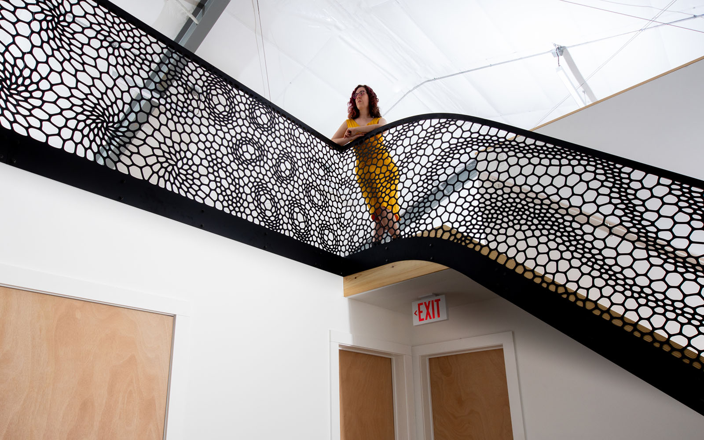](https://n-e-r-v-o-u-s.com/blog/?p=8753)

Nervous System also [created the plaques](https://n-e-r-v-o-u-s.com/blog/?p=9778) for the STUDIO for Creative Inquiry's Fund for Underwriting Creativity, Knowledge, Experimentation, Research and Yumminess, which supports antidisciplinary undergraduate research at CMU. 

[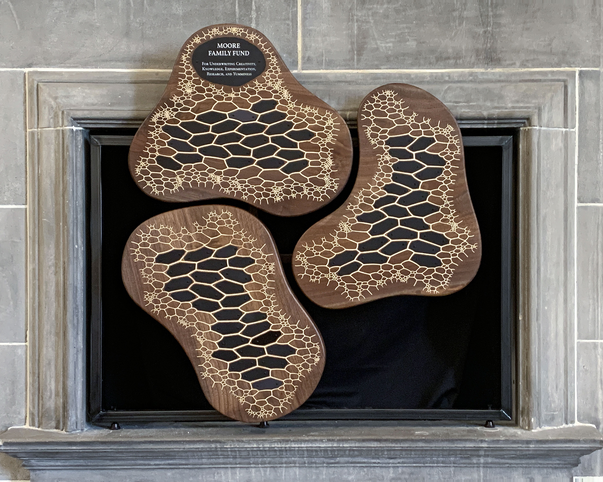](https://n-e-r-v-o-u-s.com/blog/?p=9778)
-->
